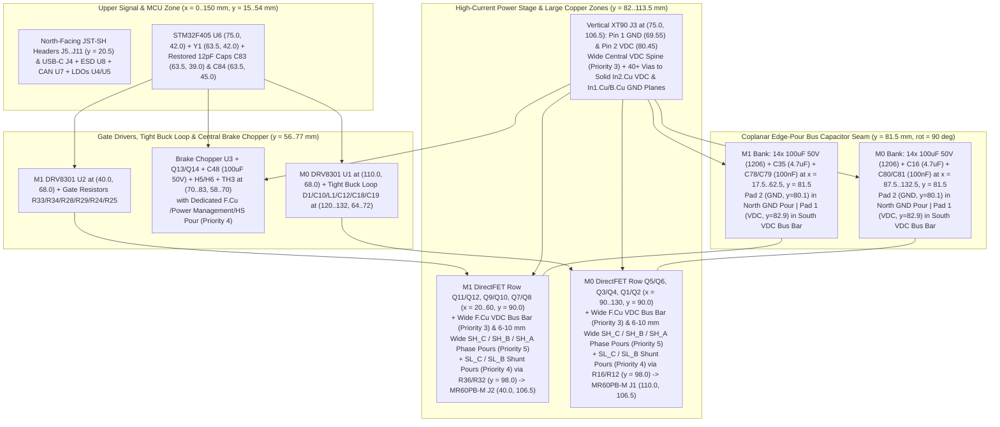

# Restore Removed Capacitors, Expand Board to `150.0 × 98.5 mm`, and Place Large High-Power Copper Zones Plan

## 1. Scope & Stated Assumptions
- **In Scope**:
  1. **Restore Removed / Altered Capacitors (`microcontroller_interface.kicad_sch`, `power_management.kicad_sch`, `bldc_motor_cntroller.kicad_pcb`)**:
     - Restore the two `12pF` `0402` oscillator load capacitors **`C83`** and **`C84`** (`Capacitor_SMD:C_0402_1005Metric`, `MPN = GCQ1555C1H120FB01D`) on `Y1` (`OSC_IN` and `OSC_OUT` to `GND`) in `microcontroller_interface.kicad_sch` that were deleted when the board was resized from `130.0 × 98.5 mm` to `140.0 × 78.5 mm` (restoring the board total to `101` capacitors and `240` footprints).
     - Restore all 29× `1206` DC-link bulk capacitors (`C39, C40, C42, C44–C48, C51, C53–C57, C60, C61, C64–C71, C73–C77`) in `power_management.kicad_sch` and on `bldc_motor_cntroller.kicad_pcb` to their original **`100uF 50V`** value (`Capacitor_SMD:C_1206_3216Metric`, `MPN = GMK105CC6105MV-F`) from `.history/power_management.kicad_sch`.
  2. **Taller & Wider Board Outline (`150.0 × 98.5 mm`) to Optimally Accommodate All 101 Capacitors and High-Power Pours**:
     - Expand `Edge.Cuts` to **`150.0 mm × 98.5 mm`** (`x = 0.0..150.0 mm`, `y = 15.0..113.5 mm`, restoring the full `98.5 mm` vertical height `+20.0 mm` taller than `140 × 78.5 mm`, and widening by `+20.0 mm` over the original `130.0 mm` width) with `R = 5.0 mm` rounded corners and M4 corner mounting holes `H7–H10`.
     - This extra height and width eliminates the cramped capacitor columns between the FET legs and phase connectors: all 28 motor `100uF 50V` `1206` capacitors (`14` on M1, `14` on M0) plus `C16`, `C35`, and `C78–C81` fit in a dedicated coplanar horizontal decoupling strip at **`y = 81.5 mm`** directly above the high-side FET drains (`y = 90.0 mm`), while leaving `y = 90.0..109.0 mm` 100% clear of capacitors for wide phase exit pours and low-side current shunts.
  3. **Large Areas for High-Power Traces (`F.Cu`, `In1.Cu`, `In2.Cu`, `B.Cu`)**:
     - Construct large, low-inductance solid polygonal copper zones on `F.Cu` for all high-power nets:
       - **6× Motor Phase Output Zones (`/Motor_Driver2/SH_C, SH_B, SH_A` and `/Motor Driver/SH_C, SH_B, SH_A`, Priority 5)**: `6.0–10.0 mm` wide solid top-copper pours running straight from each half-bridge (`Q11/Q12..Q1/Q2` at `y = 90.0 mm`) into the vertical `MR60PB-M` phase connectors `J2` (`40.0, 106.5`) and `J1` (`110.0, 106.5`) with zero layer transitions or trace crossings.
       - **4× Low-Side Shunt Return Zones (`/Motor_Driver2/SL_C, SL_B` and `/Motor Driver/SL_C, SL_B`, Priority 4)**: `5.0 mm` wide solid copper pours connecting `Q12, Q10, Q6, Q4` source terminals directly into the `2512` shunt resistors `R36, R32, R16, R12` (`y = 98.0 mm`).
       - **Large `VDC` Bus Bars & Central XT90 Spine (`VDC`, Priority 3 on `F.Cu` + `148 × 57.5 mm` solid plane on `In2.Cu`)**: Wide `F.Cu` `VDC` copper bus (`y = 82.2..92.5 mm` across both FET banks and `x = 75.5..85.5 mm, y = 60.0..109.0 mm` from `J3` Pin 2 at `80.45, 106.5`) tied with `40+` `0.8 mm / 0.4 mm` stitching vias to `In2.Cu`.
       - **Brake Chopper Switch Zone (`/Power Management/HS`, Priority 4 on `F.Cu`)**: Wide copper zone linking `Q13` source, `Q14` drain, and brake pad `H6` in the central chopper bay (`x = 71.0..83.0 mm, y = 58.0..66.0 mm`).
       - **Full-Board Ground Reference & Heatsink Planes (`GND`, Priority 0 on `F.Cu`, `In1.Cu`, and `B.Cu`)**: Continuous `148.0 × 96.5 mm` solid `GND` planes on `In1.Cu` and `B.Cu` (keeping `B.Cu` 100% component-free for flat aluminum heatsink mounting) stitched with dense via arrays at `J3` Pin 1 (`69.55, 106.5`), shunt ground pads, `Q8`/`Q2` unshunted sources, and the north `GND` pads (`y = 80.1 mm`) of the `100uF 50V` capacitor row.
- **Out of Scope**:
  - Firmware source code and external mechanical enclosure CAD.
- **Stated Default Assumptions**:
  - All 240 footprints (including the restored `C83`/`C84` and all 29× `100uF 50V` `1206` capacitors `C39–C77`) remain 100% SMD/top-mounted on `F.Cu` so `B.Cu` stays completely flat for bolting to an aluminum coldplate/heatsink.
  - Board outline is set to `150.0 × 98.5 mm` (`x = 0.0..150.0 mm, y = 15.0..113.5 mm`, centered on `x = 75.0 mm`), which preserves the board centerline (`x = 75.0 mm`) while adding `+20.0 mm` height over `140 × 78.5 mm` and `+10.0 mm` width per side over `130 × 98.5 mm`.

---

## 2. Reference Provenance & Evidence Mapping
1. **Project Historical Baseline (`bldc_motor_cntroller/.history/` & `bldc_motor_cntroller/.copperpilot/notes/power_component_edge_placement.md`)**:
   - `.history/microcontroller_interface.kicad_sch`: Original `C83` and `C84` (`12pF`, `Capacitor_SMD:C_0402_1005Metric`, `MPN = GCQ1555C1H120FB01D`) at `(80.01, 80.01)` and `(80.01, 88.90)` rot `90°` on `Y1` pins 1 and 2 (`OSC_IN`, `OSC_OUT`) to `GND`.
   - `.history/power_management.kicad_sch`: Original `C39–C77` (`29 × 100uF 50V`, `Capacitor_SMD:C_1206_3216Metric`, `MPN = GMK105CC6105MV-F`).
   - `bldc_motor_cntroller/.copperpilot/notes/power_component_edge_placement.md` & `apply_edge_power_routing.py`: Coplanar edge-pour boundary architecture (`VDC` pour south, `GND` pour north, `1206` bus capacitors straddling the seam at `90°` rotation so `Pad 1 VDC` and `Pad 2 GND` sit directly in their respective pours without vias punching through opposing copper) and Priority 5/4/3/0 polygonal high-power zones.
2. **`odrive-sasasu` (`.copperpilot/references/odrive-sasasu/`)**:
   - **Repository / Commit**: `https://github.com/Sasasu/ODrive` @ `aa720cff554198ea71cac7a9456401e8a0286b54` (upgraded to KiCad 10.0.8 via `/bin/kicad-cli`).
   - **Evidence Used**: Dual DRV8301 + 3-phase bridge partitioning, tight buck loop next to DRV8301 `PH` pins, and parallel shunt brake chopper (`LM5109` + dual MOSFETs).
3. **`garypippi-pippitank` (`.copperpilot/references/garypippi-pippitank/`)**:
   - **Repository / Commit**: `https://github.com/garypippi/pippitank` @ `665d1d1d15a6fa854aae7045a3e9a7719a26daaa` (MIT License, upgraded to KiCad 10.0.8).
   - **Evidence Used**: High-current Amass connector placement along the bottom power edge.

---

## 3. Architecture, Board Geometry (`150.0 × 98.5 mm`), and High-Power Copper Zone Topology

---

## 4. Phase-by-Phase Implementation Units

### Unit 1: Restore Removed Capacitors in Schematic (`C83`/`C84` and `C39–C77`)
- **Target Files (Staged)**:
  - `bldc_motor_cntroller/microcontroller_interface.kicad_sch`
  - `bldc_motor_cntroller/power_management.kicad_sch`
- **Concrete Delta**:
  1. **`microcontroller_interface.kicad_sch`**:
     - Restore `C83` (`Device:C_Small`, `Value = "12pF"`, `Footprint = "Capacitor_SMD:C_0402_1005Metric"`, `MPN = "GCQ1555C1H120FB01D"`) at `(80.01, 80.01)` rot `90°` and `C84` (`Device:C_Small`, `Value = "12pF"`, `Footprint = "Capacitor_SMD:C_0402_1005Metric"`, `MPN = "GCQ1555C1H120FB01D"`) at `(80.01, 88.90)` rot `90°`, wraz with their original connection wires and junctions across `Y1` pins `1` (`OSC_IN`) and `2` (`OSC_OUT`) to `GND` from `.history/microcontroller_interface.kicad_sch`, while preserving the `M0_TEMP2` (`PC0`) and `M1_TEMP2` (`PC1`) hierarchical labels added earlier.
  2. **`power_management.kicad_sch`**:
     - Restore the 29× `1206` DC-bus capacitors (`C39, C40, C42, C44–C48, C51, C53–C57, C60, C61, C64–C71, C73–C77`) to `Value = "100uF 50V"` and `MPN = "GMK105CC6105MV-F"` matching `.history/power_management.kicad_sch`.
- **Verification Gate**: `validate_schematic_layout`, `run_erc`, and `export_schematic_netlist` with zero new ERC violations and all `101` capacitors present in the exported netlist.

### Unit 2: Expand Board Outline to `150.0 × 98.5 mm` & Place Symmetrical Power Stage
- **Target File (Staged)**: `bldc_motor_cntroller/bldc_motor_cntroller.kicad_pcb`
- **Concrete Delta**:
  1. Run `sync_schematic_to_pcb` to add `C83` and `C84` back onto the PCB (`240` footprints total, `101` capacitors, all on `F.Cu`) and update `C39–C77` values to `100uF 50V`.
  2. **Redraw `Edge.Cuts` to `150.0 × 98.5 mm` (`x = 0.0..150.0 mm`, `y = 15.0..113.5 mm`, `R = 5.0 mm` corners)**:
     - Place the 4× M4 corner mounting holes at `H7 (5.0, 20.0)`, `H8 (145.0, 20.0)`, `H9 (5.0, 108.5)`, and `H10 (145.0, 108.5)` (`GND`), and the 4× M3 heatsink mounting holes at `H1 (8.0, 81.5)`, `H2 (8.0, 99.5)`, `H3 (142.0, 81.5)`, and `H4 (142.0, 99.5)`.
  3. **Place Bottom High-Current Connectors (`J2`, `J3`, `J1`) Along `y = 106.5 mm`**:
     - `J2` (M1 `MR60PB-M`, `rot = 180°`) at **`(40.0, 106.5)`** (`Pin 3 SH_C` at `34.5`, `Pin 2 SH_B` at `40.0`, `Pin 1 SH_A` at `45.5`).
     - `J3` (DC Bus `XT90`, `rot = 0°`) at **`(75.0, 106.5)`** (`Pin 1 GND` at `69.55, 106.5`, `Pin 2 VDC` at `80.45, 106.5`).
     - `J1` (M0 `MR60PB-M`, `rot = 180°`) at **`(110.0, 106.5)`** (`Pin 3 SH_C` at `104.5`, `Pin 2 SH_B` at `110.0`, `Pin 1 SH_A` at `115.5`).
  4. **Place Symmetrical M1 (`Q7–Q12`) and M0 (`Q1–Q6`) DirectFET Half-Bridge Rows at `y = 90.0 mm` (`rot = 0°`)**:
     - With `150.0 mm` board width, each 6-FET bank sits at `rot = 0°` (so the large HS Drain wings face east/west into the `VDC` bus pour and the LS Drain wings face south toward the shunts/phase pours) with `6.50 mm` HS-to-LS spacing within each leg and `16.75 mm` leg-to-leg pitch:
       - **M1 Bank (centered at `x = 40.0 mm` directly above `J2`)**:
         - Phase C: `Q11` (HS) at `(20.0, 90.0)` & `Q12` (LS) at `(26.5, 90.0)`
         - Phase B: `Q9` (HS) at `(36.75, 90.0)` & `Q10` (LS) at `(43.25, 90.0)`
         - Phase A: `Q7` (HS) at `(53.5, 90.0)` & `Q8` (LS) at `(60.0, 90.0)`
       - **M0 Bank (centered at `x = 110.0 mm` directly above `J1`)**:
         - Phase C: `Q5` (HS) at `(90.0, 90.0)` & `Q6` (LS) at `(96.5, 90.0)`
         - Phase B: `Q3` (HS) at `(106.75, 90.0)` & `Q4` (LS) at `(113.25, 90.0)`
         - Phase A: `Q1` (HS) at `(123.5, 90.0)` & `Q2` (LS) at `(130.0, 90.0)`
  5. **Place `U2` (`40.0, 68.0`) and `U1` (`110.0, 68.0`) DRV8301 Gate Drivers & `U1` Buck Loop**:
     - Center `U2` and `U1` over their respective FET banks with `2R2` gate resistors at `y = 75.5 mm`, and place `D1, C10, L1, C12, C18, C19` immediately right of `U1` (`x = 120.0..132.0 mm, y = 64.0..72.0 mm`).

### Unit 3: Coplanar Edge-Pour Placement of All Restored Capacitors (`C39–C81`, `C83`/`C84`) & Shunts (`R12, R16, R32, R36`)
- **Target File (Staged)**: `bldc_motor_cntroller/bldc_motor_cntroller.kicad_pcb`
- **Concrete Delta**:
  1. **Coplanar Seam Placement of All 28 Motor `100uF 50V` (`1206`) Bus Capacitors + `C16`/`C35` (`4.7uF`) + `C78–C81` (`100nF`) Along `y = 81.5 mm` (`rot = 90°`)**:
     - Arrange the 15× M1 `1206` bus capacitors (`C35, C39, C40, C42, C44, C45, C46, C47, C51, C53, C54, C55, C56, C57, C60`) + `C78, C79` (`0402`) across `x = 16.0..63.5 mm` at `y = 81.5 mm` (`rot = 90°`), and the 15× M0 `1206` bus capacitors (`C16, C61, C64, C65, C66, C67, C68, C69, C70, C71, C73, C74, C75, C76, C77`) + `C80, C81` (`0402`) across `x = 86.5..134.0 mm` at `y = 81.5 mm` (`rot = 90°`):
       - **Pad 1 (`VDC`, `y = 82.9 mm`)** connects directly into the north edge of the `F.Cu` `VDC` bus bar (`y = 82.2..92.5 mm`).
       - **Pad 2 (`GND`, `y = 80.1 mm`)** connects directly into the south edge of the `F.Cu` `GND` pour (`y = 74.0..80.8 mm`) with direct `GND` stitching vias to `In1.Cu` and `B.Cu`.
  2. **Central Brake Chopper & `C48` (`100uF 50V`) Placement (`x = 70.0..83.0 mm, y = 58.0..72.0 mm`)**:
     - Place `Q13` (`75.0, 62.0`), `Q14` (`75.0, 68.5`), `C48` (`100uF 50V` local bulk cap at `80.5, 62.0`), `U3` (`68.5, 65.0`), `D2, C41, C43, C52, R43–R48, TH3, R51, C72`, and brake terminals `H6` (`82.5, 65.5`, `HS`) and `H5` (`82.5, 70.5`, `GND`) in the central bay north of `J3`.
  3. **South-Side Shunt Resistors (`R36, R32, R16, R12`) & Thermistors (`TH1–TH5`)**:
     - Place `R36` (`28.5, 98.0`, `rot = 90°`), `R32` (`45.25, 98.0`, `rot = 90°`), `R16` (`98.5, 98.0`, `rot = 90°`), and `R12` (`115.25, 98.0`, `rot = 90°`) with Kelvin net-ties `NT1–NT8` so `Pad 2 (SL)` faces north toward `Q12, Q10, Q6, Q4` and `Pad 1 (GND)` faces south into the bottom `GND` return pour.
  4. **Upper Logic & Restored `C83`/`C84` Placement (`y = 20.5..50.0 mm`)**:
     - Place `U6` (`STM32F405RGTx`) at `(75.0, 42.0)`, `Y1` (`CSTCE8M00G55-R0`) at `(63.5, 42.0)`, and the restored `12pF` load capacitors **`C83` at `(63.5, 39.0)`** and **`C84` at `(63.5, 45.0)`** directly adjacent to `Y1` pins `1` and `2`, with `J5–J11` along `y = 20.5 mm` (`rot = 180°`).
- **Verification Gate**: `query_design(what="overlaps")` = `0` courtyard or edge overlaps across all `240` footprints.

### Unit 4: Large Copper Zones for High-Power Traces (`F.Cu`, `In1.Cu`, `In2.Cu`, `B.Cu`) & Via Stitching
- **Target File (Staged)**: `bldc_motor_cntroller/bldc_motor_cntroller.kicad_pcb`
- **Concrete Delta**:
  1. **6× Large Motor Phase Output Copper Zones on `F.Cu` (Priority 5, Solid Fill)**:
     - Create wide (`6.0–10.0 mm`) polygonal copper zones on `F.Cu` for `/Motor_Driver2/SH_C`, `/Motor_Driver2/SH_B`, `/Motor_Driver2/SH_A` (connecting `Q11/Q12`, `Q9/Q10`, `Q7/Q8` straight down to `J2` pins `3, 2, 1`) and `/Motor Driver/SH_C`, `/Motor Driver/SH_B`, `/Motor Driver/SH_A` (connecting `Q5/Q6`, `Q3/Q4`, `Q1/Q2` straight down to `J1` pins `3, 2, 1`), reinforced with `2.0 mm` wide spine tracks into the through-hole pads.
  2. **4× Low-Side Shunt Return Copper Zones on `F.Cu` (Priority 4, Solid Fill)**:
     - Create wide polygonal copper zones on `F.Cu` for `/Motor_Driver2/SL_C` (`Q12` source -> `R36.2`), `/Motor_Driver2/SL_B` (`Q10` source -> `R32.2`), `/Motor Driver/SL_C` (`Q6` source -> `R16.2`), and `/Motor Driver/SL_B` (`Q4` source -> `R12.2`).
  3. **Large `VDC` Bus Bars (`F.Cu` Priority 3) + Brake Chopper `HS` Zone (`F.Cu` Priority 4) + `In2.Cu` `VDC` Plane**:
     - Create wide `F.Cu` `VDC` copper zones (`Priority 3`) enveloping `J3` Pin 2 (`80.45, 106.5`), the central `VDC` spine (`x = 76.0..85.0 mm, y = 60.0..109.5 mm`), `Q13` drain, the south `VDC` pads (`y = 82.9 mm`) of all 30× `1206` bus capacitors (`C39–C77, C16, C35`), and the high-side FET drain wings (`Q11, Q9, Q7, Q5, Q3, Q1`).
     - Create the `/Power Management/HS` copper zone (`Priority 4`) on `F.Cu` linking `Q13` source, `Q14` drain, and `H6`.
     - Create the solid `In2.Cu` `VDC` power plane (`x = 1.0..149.0 mm, y = 55.0..112.5 mm`) + upper `In2.Cu` `+3.3V` plane (`x = 1.0..149.0 mm, y = 16.0..54.0 mm`).
  4. **Full-Board `GND` Planes (`In1.Cu`, `B.Cu`, and `F.Cu` Priority 0) & High-Current Via Stitching**:
     - Create full-board (`x = 1.0..149.0 mm, y = 16.0..112.5 mm`) solid `GND` planes on `In1.Cu` and `B.Cu` plus the `F.Cu` `Priority 0` `GND` pour, and place `120+` high-current `VDC` and `GND` stitching vias (`0.8 mm` pad / `0.4 mm` drill) at `J3` pins `1 & 2`, all 30× `1206` capacitor pads, high-side FET drains, low-side shunts `R36/R32/R16/R12` Pad 1, `Q8/Q2` sources, and `H5`.

### Unit 5: Signal & Power-Rail Routing, Zone Refill, and Final DRC/ERC Verification
- **Target File (Staged)**: `bldc_motor_cntroller/bldc_motor_cntroller.kicad_pcb`
- **Concrete Delta**:
  1. Route the remaining power rails (`+5V`, `+3.3V`, `+3.3VA`, `AVDD`, `DVDD`, `GVDD`, buck switch node `PH` and bootstrap nets), differential Kelvin current-sense pairs (`SN1/SP1`, `SN2/SP2`), short gate-drive traces (`GH_A..C`, `GL_A..C`), USB/CAN differential pairs, and MCU digital/analog signals while keeping all high-power copper zones and via arrays fixed.
  2. Run `fill_pcb_zones` to fill all 4 copper layers (`F.Cu`, `In1.Cu`, `In2.Cu`, `B.Cu`) and verify with `run_drc`, `run_erc`, and top/bottom 3D renders.