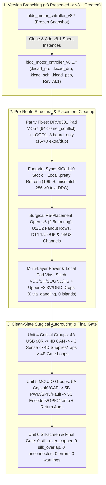

# V8.1 Snapshot, Footprint Normalization, Surgical Re-Placement, Full Re-Route, and Zero-DRC Completion Plan

## 1. Scope, Preserved Baseline, and Operating Assumptions

- **Primary Objective**:
  1. **Preserve `bldc_motor_cntroller_v8.*` Untouched**: Keep `bldc_motor_cntroller_v8.kicad_pro`, `.kicad_dru`, `.kicad_sch`, and `.kicad_pcb` intact at their current promoted state (`249` electrical/mechanical footprints + `FD1–FD3` + `TP1–TP12`, `7` netclasses, `410` power/thermal vias) as the frozen `v8` snapshot.
  2. **Save & Complete `bldc_motor_cntroller_v8.1.*`**: Create/sync the complete `bldc_motor_cntroller_v8.1` project set (`.kicad_pro`, `.kicad_dru`, `.kicad_sch`, `.kicad_pcb` with title-block `Rev v8.1` and dual `v8` + `v8.1` subsheet instance mappings so both projects remain 100% ERC- and parity-valid).
  3. **Eliminate Every DRC Error, Warning, Unconnected Item & Parity Issue (`0 / 0 / 0 / 0`)**: Resolve all categories currently reported by `kicad-cli pcb drc --schematic-parity` without relaxing DRC rules or suppressing severities:
     - `schematic_parity` (`79 -> 0`): `64` `net_conflict` (`U1`/`U2` thermal via pads `"V"` -> `"57"`), `8` `extra_footprint` + `7` `duplicate_footprints` (`8x G***` graphical logos -> unique `LOGO1–LOGO8` with `board_only exclude_from_pos_files exclude_from_bom`).
     - `lib_footprint_mismatch` (`199 -> 0`) & `text_height` / `text_thickness` (`143 + 143 -> 0`): Refresh legacy KiCad-5 embedded footprints (`0.50 x 0.50 mm`, `0.07 mm` stroke text) from KiCad `10.0.8` stock and synced project-local `.pretty` libraries (`1.0 x 1.0 mm`, `0.15 mm` stroke text, `0.0 mm` board-level mask clearance).
     - `unconnected_items` (`275 -> 0`), `isolated_copper` (`1 -> 0`), `via_dangling` (`0`), `clearance` / `hole_clearance` (`0`): Surgically re-place congested fanout passives/test points, stitch multi-layer power/return pads cleanly, re-route all `173` nets from a clean slate, and refill all copper zones after every routing pass.
     - `silk_over_copper` (`40 -> 0`) & `silk_overlap` (`6 -> 0`): Reposition reference designators and port icons onto clean soldermask areas clear of pads, vias, and neighboring silkscreen.

- **Confirmed User Decisions Carried Forward**:
  - Keep `C_HF2/C_HF3` (`M0`) and `C_HF5/C_HF6` (`M1`) wired `VDC -> SL_B / SL_C` (`< 2.5 mm` half-bridge switching commutation loop) while `C78–C81` and `28x 1206` ceramics bypass `VDC -> GND`.
  - Keep existing passive/semiconductor electrical values unchanged (`VDC <= 30–32 V` operating ceiling noted for `40 V` `IRF7480MTRPBF` FETs).
  - Use `0.80 mm` pad / `0.40 mm` drill vias for `Power` stitching arrays and Git checkpoints per verified unit.

- **Stated Reversible Placement & Mechanical Defaults**:
  1. **Fixed Mechanical Anchors vs. Re-Placeable Components**:
     - **Fixed**: `150.0 x 98.5 mm` (`R = 5.0 mm`) `Edge.Cuts` outline, mounting holes `H1–H4` (`M3`) and `H7–H10` (`M4`), external connectors `J1–J11` and `SW1`, brake pads `H5–H6`, fiducials `FD1–FD3`, and the symmetric `30 A+` power-stage MOSFET/shunt/bus-cap banks (`Q1–Q12`, `R12/R16/R32/R36`, `C_HF1–C_HF6`, `C39–C77`), plus `0` backside components (`B.Cu` heatsink side stays 100% component-free).
     - **Authorized for Surgical Re-Placement**: Congested passives, regulators, ESD/transceiver helpers, and test points in the signal/control region (`y = 23.0..84.0 mm`) — specifically around `U6` (`STM32F405RGTx`), `U1`/`U2` (`DRV8301DCAR` north/south `0402` fanout rows), `D1`/`L1`/`U4`/`U5` buck/LDO cluster, `U3`/`Q13`/`Q14` gate-drive passives, `J4`/`U8` USB-C front-end, and `TP1–TP12` — to eliminate pad-throat bottlenecks and silkscreen collisions before autorouting.
  2. **Open KiCad Lock File Caution**: `bldc_motor_cntroller/~bldc_motor_cntroller_v8.1.kicad_pro.lck` indicates `v8.1` is currently open in KiCad; close or revert `bldc_motor_cntroller_v8.1` in KiCad before running Build so live GUI state does not overwrite promoted `.kicad_pro`/`.kicad_pcb` updates.

---

## 2. Reference & Evidence Mapping

| Functional Block / Decision | Reference ID / Artifact | Revision / Provenance | Role & Adaptation for `v8.1` |
|---|---|---|---|
| **STM32F405 + Dual DRV8301 Fanout, Gate Loops & Sense Partitioning** | `odrive-sasasu` (`.copperpilot/references/odrive-sasasu/source/ODrive.kicad_pcb`, `M0.kicad_sch`, `M1.kicad_sch`, `drv8301.pdf`) | `aa720cff554198ea71cac7a9456401e8a0286b54` (inspect-only, upgraded to KiCad `10.0.8`, `SHA-256: cda640fb58e6`) + TI `SLOS719F` | Governs `2.5–3.5 mm` fanout clearance ring around `LQFP-64` (`U6`) and `HTSSOP-56` (`U1`, `U2`) `0.50 mm`-pitch pads, differential `SP/SN` Kelvin sense routing north of `y = 80.6 mm` power pours, and `DRV8301DCA` Pin `57` thermal-pad jumper mapping (`V -> 57`). |
| **LM5109BSD (`U3`) & CSD18540Q5B (`Q13`, `Q14`) Thermal Land Patterns** | `odrive-sasasu` (`.copperpilot/references/odrive-sasasu/source/lm5109.pdf`) + TI `SLPS516` | TI `SNVS572` + `SLPS516` | `5x 0.50/0.25 mm` thermal vias in `U3.9` (`GND`), `9x 0.60/0.30 mm` vias in `Q13.5` (`VDC -> In2.Cu VDC`) and `Q14.5` (`F.Cu HS -> B.Cu HS`). |
| **AMASS `MR60PB-M` (`J1`, `J2`) & `XT90` (`J3`) 30A+ Current Sharing** | `garypippi-pippitank` (`.copperpilot/references/garypippi-pippitank/source/pcb/pippitank-esc-adaptor/rev_a/pippitank-esc-adaptor.kicad_pcb`) | `665d1d1d15a6fa854aae7045a3e9a7719a26daaa` (MIT, upgraded to KiCad `10.0.8`, `SHA-256: 5d28b6cf80c0`) | Parallel `2 oz` `F.Cu` + `B.Cu` phase pours stitched with `>= 16x 0.80/0.40 mm` vias per phase (`> 35 A` continuous array rating) and silkscreen keepout around connector solder masks. |
| **7 Netclasses, 90-Ohm USB Microstrip & JLCPCB 4L 2oz DFM** | `.copperpilot/notes/v6_routing_rules_and_netclasses.md` | IPC-2221C + 2D field solver (`h = 0.110 mm` `FR4 3313`, `t = 70 um`) + JLCPCB 4L `2 oz` rules | `USB` (`W = 0.155 mm, S = 0.220 mm -> 88.4–89.7 Ohm` on `F.Cu` over `In1.Cu GND`), `Gate` (`0.30 mm`), `Supply` (`0.50 mm`, `0.25 mm` fine-pitch neckdown), `Sense` (`0.20 mm`), `CAN` (`0.20 mm`), `Power` (`0.80/0.40 mm` vias), and `>= 1.0 x 1.0 mm / 0.15 mm` silkscreen text. |

---

## 3. `v8.1` Zero-DRC Architecture & Execution Flow

---

## 4. Incremental Execution Units

### Unit 1: Branch `bldc_motor_cntroller_v8.1` & Eliminate All 79 Schematic-Parity Warnings (`unit-1-branch-v8-1-and-schematic-instance-parity`)
- **Target Files (Staged)**:
  - `bldc_motor_cntroller/bldc_motor_cntroller_v8.1.kicad_pro`
  - `bldc_motor_cntroller/bldc_motor_cntroller_v8.1.kicad_dru`
  - `bldc_motor_cntroller/bldc_motor_cntroller_v8.1.kicad_sch`
  - `bldc_motor_cntroller/power_management.kicad_sch`, `microcontroller_interface.kicad_sch`, `motor_driver.kicad_sch`, `motor_driver2.kicad_sch`, `io_interface.kicad_sch` (append `"bldc_motor_cntroller_v8.1"` instance entries while preserving `"bldc_motor_cntroller_v8"` and `"bldc_motor_cntroller"` byte-intact)
  - `bldc_motor_cntroller/bldc_motor_cntroller.pretty/DRV8301DCA.kicad_mod` & `M00/M1/batt/DFU/USB/ENC0/ENC1/++.kicad_mod`
  - `bldc_motor_cntroller/bldc_motor_cntroller_v8.1.kicad_pcb`
- **Concrete Actions**:
  1. Sync `bldc_motor_cntroller_v8.1.kicad_pro` and `bldc_motor_cntroller_v8.1.kicad_dru` from verified `v8` (`Power` via `0.80/0.40 mm`, `7` netclasses, `0.0 mm` `solder_mask_to_copper_clearance`, `HV_Power_Track_Clearance_Outside_Drivers` `0.25 mm` rule).
  2. Create `bldc_motor_cntroller_v8.1.kicad_sch` (`rev "v8.1"`) and append `(project "bldc_motor_cntroller_v8.1" ...)` instance blocks to every symbol and power symbol across root + all 5 subsheets so both `v8` and `v8.1` export identical 249-component netlists with `0` ERC errors.
  3. In `bldc_motor_cntroller.pretty/DRV8301DCA.kicad_mod`, update the `32` exposed-pad thermal via jumper pads from `(pad "V" ...)` to `(pad "57" ...)` (`duplicate_pad_numbers_are_jumpers yes` already active) so all `64` thermal via pads on `U1` and `U2` map to schematic Pin `57` (`GND`).
  4. Update the `8` graphical port-icon footprints (`M00`, `M1`, `batt`, `DFU`, `USB`, `ENC0`, `ENC1`, `++`) in `bldc_motor_cntroller.pretty/` to `(attr board_only exclude_from_pos_files exclude_from_bom)` and assign unique hidden references `LOGO1–LOGO8` on `bldc_motor_cntroller_v8.1.kicad_pcb`.
- **Exit Check**: `bldc_motor_cntroller_v8.*` SHA-256 hashes verified unchanged (except shared subsheets retaining `0` ERC errors on `v8`); `run_erc` on `v8.1` = `0` errors; `run_drc` on `v8.1` reports `schematic_parity_count = 0` (`79 -> 0`).

### Unit 2: Normalize All 199 Footprints & Surgically Re-Place Congested Components (`unit-2-normalize-footprints-and-surgical-replacement`)
- **Target Files (Staged)**:
  - `bldc_motor_cntroller/bldc_motor_cntroller.pretty/*.kicad_mod`, `MG-WDSON-8.pretty/Infineon-MG-WDSON-8-05_2016-901-MFG.kicad_mod`, `Package_SON.pretty/WSON-8_4x4mm_P0.8mm.kicad_mod`, `Connector_AMASS.pretty/*.kicad_mod`
  - `bldc_motor_cntroller/bldc_motor_cntroller_v8.1.kicad_pcb`
- **Concrete Actions**:
  1. **Eliminate `199` `lib_footprint_mismatch` + `286` `text_height` / `text_thickness` Warnings**:
     - Ensure all project-local `.pretty` footprints use standard `1.0 x 1.0 mm`, `0.15 mm` stroke silkscreen `Reference` fonts and clean F.SilkS outlines clear of copper pads (`J1`/`J2` `AMASS_MR60PB-M` silkscreen lines trimmed clear of pad mask openings).
     - Refresh all `199` mismatched PCB footprints (`C_0402`, `R_0402`, `C_1206`, `R_2512`, `D_SOD-123F`, `SOT-23-5/6`, `SOIC-8`, `LQFP-64`, `USB_C`, `JST_SH_*`, `NetTie-2`, `Fuse_1206`, `LED_0402`, `L_Taiyo-Yuden_NR-60xx`, `TDSON-8-1`, `DRV8301DCA`, `CSTCE8M00G55-R0`, `Infineon-MG-WDSON-8`) via `replace_pcb_footprint(..., preserve_pose=true, preserve_properties=true, preserve_nets="strict")`.
  2. **Surgical Component Re-Placement to Open Routing Channels (`pose_pcb_footprint`)**:
     - **`U6` (`STM32F405RGTx` at `75.0, 45.0`) Fanout Ring (`>= 2.5 mm` clear perimeter)**:
       - Move right-side components (`C91, C90, C7, C6, D3, R50`) from `x = 81.6..83.4` out to `x = 84.4..85.5` and space `TP6, TP8, TP9, TP2, TP3, TP12` cleanly along `x = 87.8..89.5` (`>= 2.6 mm` vertical pitch), opening a `3.5 mm` `F.Cu` fanout alley along `U6` pins `33..48` (`USB_DN/DP` + `M0/M1` `PWM` + `EN_GATE`).
       - Move top-side `C89, C27, C28` to `y = 35.8` and `TP10, TP11` to `(75.5, 32.2)` and `(79.0, 32.2)`, opening a `2.8 mm` north fanout channel for `SWCLK`, `SPI3`, `CAN_D/R`, `ENC0/1_A/B`, and `nFAULT`.
       - Nudge left-side `C85, C86, C83, Y1, C84, C92, C93` (`x = 60.5..66.2`) so `U6` pins `1..16` have an unobstructed `2.5 mm` escape channel while keeping `Y1 + C83/C84` within `3.5 mm` of `PH0/PH1` (`U6:5/6`) and `C88`/`C90` within `3.0 mm` of `VCAP_1/2`.
     - **`U1` (`111.8, 76.45`) & `U2` (`41.8, 76.45`) (`DRV8301DCAR`) North/South Fanout Rows**:
       - Space the north `0402` passive banks (`y = 65.5..69.2 mm` instead of `67.1..69.8 mm`) on a clean `2.0 mm` pitch aligned directly with `U1`/`U2` pins `1..28` so `SO1/SO2`, `AVDD`, `DVDD`, `GVDD`, `CP1/CP2`, `EN_GATE`, `SPI`, `DTC`, `DC_CAL`, `COMP`, and `VSENSE` escape straight north on `F.Cu` without `B.Cu` detours.
       - Adjust south sense/bootstrap `0402` caps (`C2, C3, C13–C15, C36` and `C23, C24, C32–C34`) at `y = 81.9..82.2 mm` and gate resistors (`R1, R2, R8, R9, R13, R14` and `R24, R25, R28, R29, R33, R34`) at `y = 83.6 mm` so `BST_A..C`, `GH_A..C`, `GL_A..C`, and `SP/SN` connect without blocking each other.
     - **Buck / LDO (`D1, L1, C12, C18, C19, C101, R62, TH4, U4, U5`) & USB-C (`U8, R52, R53, R64, R65, TP4, TP5`)**:
       - Separate `D1`, `C101`, `R62`, and `TH4` (`>= 0.5 mm` courtyard margin) to clear the `D1` silkscreen overlap and open a straight `Net-(D1-K)` (`PH`) path from `U1:50/51` to `D1`/`L1` and `+5V` corridor from `L1 -> C19/C12/C18 -> TP1 -> U4/U5`.
       - Align `U8`, `R52`, `R53`, `TP4`, `TP5` inline with `J4` (`y = 35.05 / 36.95 mm`) and offset `R64`/`R65` (`y = 31.6 / 40.4 mm`) for straight `90-Ohm` `USB` differential entry.
- **Exit Check**: `run_drc` on `v8.1` reports `lib_footprint_mismatch = 0`, `text_height = 0`, `text_thickness = 0`, `courtyards_overlap = 0`, and `solder_mask_bridge = 0`.

### Unit 3: Clean-Slate Copper Zones, Power-Stage Arrays & Zero-Dangling Return Vias (`unit-3-power-planes-and-zero-dangling-via-stitching`)
- **Target File (Staged)**:
  - `bldc_motor_cntroller/bldc_motor_cntroller_v8.1.kicad_pcb`
- **Concrete Actions**:
  1. Call `unroute_pcb_all(include_vias=true)` on staged `v8.1` to clear all legacy KiCad-5 track stubs and any misaligned vias before placing clean, post-replacement power/return stitching.
  2. Verify copper zone geometry:
     - `In1.Cu`: Full-board continuous `GND` reference plane `[1.0, 16.0] .. [149.0, 112.6]`.
     - `In2.Cu`: Upper `+3.3V` logic plane `[1.0, 16.0] .. [149.0, 56.3]` + `1.2 mm` split + lower `VDC` bus plane `[1.0, 57.5] .. [149.0, 112.5]`.
     - `F.Cu` & `B.Cu`: High-current `VDC`, `SH_A..C`, `SL_B..C`, `HS`, and `GND` power-stage pours (`y >= 80.5 mm` plus `Q13/Q14` brake pours), keeping `F.Cu` and `B.Cu` `y = 16.0..80.0 mm` free of orphan outer `GND` pours so signal routing channels stay open and zero single-layer `GND` vias can occur.
  3. Place engineered multi-layer vias where **every single via connects >= 2 copper layers/items**:
     - Power-stage `0.80/0.40 mm` arrays stitching overlapping `F.Cu <-> In2.Cu/In1.Cu <-> B.Cu` pours on `VDC`, `SH_A..C` (`>= 16` vias/phase), `SL_B..C` (`>= 8` vias/shunt), and power-stage `GND` (`J3.1`, `R12/R16/R32/R36`, `Q2/Q8`, `C39–C81` `GND` pads connected by short `F.Cu` stub/pour to `In1.Cu`/`B.Cu` `GND`).
     - Exposed-pad thermal arrays: `5x 0.50/0.25 mm` inside `U3.9` (`GND`), `9x 0.60/0.30 mm` inside `Q13.5` (`VDC`), and `9x 0.60/0.30 mm` inside `Q14.5` (`F.Cu HS <-> B.Cu HS`).
     - Dedicated short `F.Cu` pad-escape stubs + `0.60/0.30 mm` vias dropping upper `+3.3V` pads (`24` pads in `y < 56.3 mm`) directly into `In2.Cu +3.3V` and all upper/mid-board `GND` SMD pads directly into `In1.Cu GND`.
  4. Run `fill_pcb_zones` on staged `v8.1`.
- **Exit Check**: `run_drc` reports `isolated_copper = 0`, `via_dangling = 0`, `clearance = 0`, `hole_clearance = 0`, `annular_width = 0`, and `GND`, `VDC`, `HS`, and upper `+3.3V` pours are 100% unified.

### Unit 4: Surgical Autorouting of Critical `USB`, `CAN`, `Sense`, `Supply` & `Gate` Groups (`unit-4-surgical-reroute-usb-can-sense-supply-and-gate`)
- **Target File (Staged)**:
  - `bldc_motor_cntroller/bldc_motor_cntroller_v8.1.kicad_pcb`
- **Concrete Actions** (headless FreeRouting via `.copperpilot/skills/kicad_autorouter/main.py route --platform linux`, one `--nets` group per run, followed by `fill_pcb_zones` and DRC verification):
  1. **Group 4A — `USB` 90-Ohm Differential Pair**: Route `USB_J4_DN`, `USB_J4_DP`, `USB_DN`, `USB_DP` (`J4 -> U8 -> R52/R53 -> TP4/TP5 -> U6:44/45`) on `F.Cu` over solid `In1.Cu GND`; verify length and skew with `lengths --target-skew-mm 2.0`.
  2. **Group 4B — `CAN` Differential Bus & Transceiver**: Route `CAN_H`, `CAN_L`, `CAN_D`, `CAN_R` (`J7/J8 <-> R54 <-> U7 <-> U6:61/62`).
  3. **Group 4C — `Sense` Kelvin Shunt Inputs & Amplifier Outputs**: Route `Net-(NT1,3,5,7-Pad1)`, `M0/M1 SP1, SN1, SP2, SN2`, `Net-(U1,U2-SO1,SO2)`, and `M0_SO1, M0_SO2, M1_SO1, M1_SO2` (including `TP8–TP11`) over solid `In1.Cu GND`.
  4. **Group 4D — `Supply` Corridors & Driver Power/Bootstrap Taps**: Route `+5V`, `GVDD` (`+ TP7`), `+3.3VA` (`+ TP3`), south `+3.3V` drops (`U1:49/R19–R21`, `U2:49/R39–R40`), `Net-(D1-K)` (`U1` buck `PH -> D1/L1/C10`), `Net-(D2-K)`, `Net-(F1-Pad1)`, `AVDD`, `DVDD`, `CP1/CP2`, `BST_*`, and short `U1/U2` `PVDD/SH/SL` taps.
  5. **Group 4E — `Gate` Drive Loops (`Q1–Q14`, `U1–U3`)**: Route `M0/M1 GH_A..C, GL_A..C`, `Net-(Q1..Q14-G)`, and `Net-(U3-HO, LO)` at `0.30 mm` width.
- **Exit Check**: `0` `unconnected_items` across all `USB`, `CAN`, `Sense`, `Supply`, `Power`, and `Gate` nets, `0` DRC errors, `0` `via_dangling`, and documented `USB` skew telemetry.

### Unit 5: Surgical Autorouting of MCU Digital, `PWM`, `SPI3`, Encoders, GPIOs & Return Audit (`unit-5-reroute-mcu-digital-io-and-return-path-audit`)
- **Target File (Staged)**:
  - `bldc_motor_cntroller/bldc_motor_cntroller_v8.1.kicad_pcb`
- **Concrete Actions**:
  1. **Group 5A — `U6` Local Crystal, `VCAP`, `NRST` & `BOOT0`**: Route `Net-(U6-PH0)`, `Net-(U6-PH1)`, `Net-(U6-VCAP_1)`, `Net-(U6-VCAP_2)`, `Net-(U6-NRST)`, `BOOT0`, and `Net-(D3-A)` on `F.Cu` (`0` vias on crystal/`VCAP`).
  2. **Group 5B — Motor `PWM`, `SPI3`, Brake Control & Faults**: Route `M0_AH..M0_CL`, `M1_AH..M1_CL`, `AUX_H`, `AUX_L`, `SPI_SCK`, `SPI_MISO`, `SPI_MOSI`, `SPI_M0_nCS`, `SPI_M1_nCS`, `EN_GATE`, `nFAULT` (`+ TP6`), `PWRGD`, and `nOCTW`.
  3. **Group 5C — Encoders, `SWD`, `GPIO_1..8`, `USB_CC`, Analog Temps & `DRV8301` Local Passives**: Route `ENC0_A/B/Z`, `ENC1_A/B/Z`, `DEBUG_SWDIO`, `DEBUG_SWCLK`, `GPIO_1..8`, `USB_CC1/CC2`, `VBUS_S`, `M0_TEMP`, `M1_TEMP`, `AUX_TEMP`, `TEMP_SENSE_2`, and `U1/U2` local `COMP, C20, DC_CAL, DTC, RT_CLK, SS_TR, VSENSE` nets.
  4. **Return-Path & Layer-Transition Audit**: Inspect every signal via; eliminate or add a local `GND` return via (`<= 2.0 mm`) for any layer transition and ensure zero signal traces run on `B.Cu` beneath the `y >= 57.5 mm` `In2.Cu VDC` switching plane.
  5. Run `fill_pcb_zones` and `run_drc`.
- **Exit Check**: `list_nets(detailed=true)` shows `173 / 173` nets `fully_routed`, `run_drc` reports `unconnected_items = 0`, `errors = 0`, `via_dangling = 0`, and `isolated_copper = 0`.

### Unit 6: Silkscreen Cleanup, Port Markings & Final Zero-DRC / 3D Verification Gate (`unit-6-silkscreen-cleanup-and-zero-drc-final-gate`)
- **Target File (Staged)**:
  - `bldc_motor_cntroller/bldc_motor_cntroller_v8.1.kicad_pcb`
- **Concrete Actions**:
  1. Load `pcb-layout-engineer` (`Cleanup and verification`) and `pcb-dfm-engineer` (`Sequence`).
  2. **Resolve All Remaining Silkscreen Warnings (`silk_over_copper -> 0`, `silk_overlap -> 0`)**:
     - Move every reference designator flagged over solder-mask openings, vias, or neighboring silkscreen onto clean `F.SilkS` areas with consistent `1.0 x 1.0 mm` (`>= 0.80 mm`), `0.15 mm` stroke orientation.
     - Position `LOGO1–LOGO8` port icons next to their corresponding connectors or remove redundant parked icons if text callouts are cleaner, ensuring zero overlap with pads or board edges.
  3. **Add Functional, Identity-Safe `F.SilkS` Markings (`place_pcb_text`)**:
     - Board title `"Open Drive"` (`1.5 x 1.5 mm`, `0.22 mm` stroke) and revision `"Rev v8.1"` (`1.2 x 1.2 mm`, `0.18 mm` stroke) in open top-right silkscreen area (`x = 125.0..136.0, y = 22.0..26.5 mm`) — zero company/author branding.
     - `SW1` legend `"BOOT0: RUN <-> DFU"`, `J3` polarity `"+"` / `"-"`, `J1` `"M0 (A/B/C)"`, `J2` `"M1 (A/B/C)"`, `H6`/`H5` `"BRAKE+"`/`"BRAKE-"`, `J9` `"SWD"`, `J7/J8` `"CAN"`, `J10` `"ENC0"`, `J11` `"ENC1"`, and compact net callouts next to `TP1–TP12`.
  4. **Final Verification Sweep**:
     - Run `fill_pcb_zones` on staged `bldc_motor_cntroller_v8.1.kicad_pcb`.
     - Run `run_erc` on both `bldc_motor_cntroller_v8.1.kicad_sch` and `bldc_motor_cntroller_v8.kicad_sch` (`0` errors on both).
     - Run `run_drc` (`--schematic-parity`, no ignore flags) on `bldc_motor_cntroller_v8.1.kicad_pcb` confirming **`errors = 0`, `warnings = 0`, `unconnected_items = 0`, `schematic_parity = 0`**.
     - Export top/bottom 3D renders and per-layer SVG/PNG verification plots, update `.copperpilot/oracle/` records, and write the final verification report at `.copperpilot/notes/v8_1_zero_drc_completion.md`.
- **Exit Check**: `run_erc` = `0` errors; `run_drc` on `bldc_motor_cntroller_v8.1.kicad_pcb` = **`0` errors, `0` warnings, `0` unconnected items, `0` schematic-parity issues**; `bldc_motor_cntroller_v8.kicad_pcb` preserved intact.
