# V8 Power-Stage Via Arrays, Netclass Rules, Signal Routing, and DFM Completion Plan

## 1. Scope, Confirmed Decisions, and Operating Assumptions

- **Confirmed User Decision**:
  - **`C_HF1–C_HF6` (`100nF 100V` `0603` at `y = 90.45 mm`)**: **Keep `C_HF2/C_HF3` (`M0`) and `C_HF5/C_HF6` (`M1`) wired `VDC -> SL_B / SL_C`** (`C_HF1/C_HF4` remain `VDC -> GND`). This closes each `40 V` `IRF7480MTRPBF` half-bridge's high-$di/dt$ switching commutation loop directly from high-side drain to low-side source (`< 2.5 mm` loop) without traversing the `1–2 nH` `2512` shunt inductance (`R12/R16/R32/R36`), while `C78–C81` (`100nF 50V`) and `28x 1206` ceramics at `y = 81.5 mm` already bypass `VDC -> GND`.

- **In Scope**:
  1. **Optical Fiducials (`FD-001`) & Missing Test Points**: Add `FD1–FD3` (`Fiducial_1mm_Mask2mm`) and `TP7–TP12` (`GVDD`, `M0_SO1`, `M0_SO2`, `M1_SO1`, `M1_SO2`, `GND` — complementing existing `TP1=+5V`, `TP2=+3.3V`, `TP3=+3.3VA`, `TP4=USB_DN`, `TP5=USB_DP`, `TP6=nFAULT`) in schematic + PCB with 100% netlist parity.
  2. **Netclasses, DRC Clearances & Upper `In2.Cu` `+3.3V` Plane**: Configure 7 IPC-2221 / `90 Ohm` USB 2.0 netclasses, `.kicad_dru` voltage/pad-entry rules (`>= 0.25–0.30 mm` `Power` clearance outside `0.50 mm`-pitch `U1/U2` pads, exceeding IPC-2221C `36 V` `B2/B4` limits by `> 2x`), `0.0 mm` fine-pitch solder-mask expansion on `0.50 mm`-pitch ICs, and a dedicated upper `In2.Cu` `+3.3V` logic pour (`y = 16.0..56.3 mm`, `1.2 mm` clear of `In2.Cu VDC` at `y = 57.5 mm`).
  3. **Power-Stage Current-Sharing Via Arrays & `TV-001` Thermal Vias**: Stitch all `VDC` (`22 -> 1` island), `SH_A/B/C` (`5 -> 1` each), `SL_B/SL_C` (`2 -> 1` each), `GND` (`14 -> 1`), and `HS` pours across `F.Cu`, `In1.Cu`, `In2.Cu`, and `B.Cu` (`>= 16` parallel `0.80/0.40 mm` vias per `30 A` motor phase + `5` thermal vias inside `U3.9`, `9` inside `Q13.5` on `VDC`, and `9` inside `Q14.5` into `B.Cu` `HS` zone `a9db436b`) **before** signal routing so power islands are unified while `y = 16.0..79.5 mm` routing channels stay 100% open.
  4. **Surgical Multi-Group Signal & Supply Routing**: Route all `120` unrouted nets via headless FreeRouting (`v2.2.4` via `/usr/bin/python3` + Java `25`), prioritizing `F.Cu` over continuous `In1.Cu GND` so fast edges never reference `In2.Cu VDC` switching ripple.
  5. **Silkscreen & Final Manufacturing Verification**: Add `"Open Drive"`, `"Rev v8"`, `SW1` (`BOOT0: DFU <-> RUN`), `J3` `+/-` polarity, connector port, and `TP1–TP12` labels on `F.SilkS`, refill all zones, and pass full `run_erc` and `run_drc`.

- **Out of Scope**:
  - Resizing the `150.0 x 98.5 mm` (`R=5.0 mm`) board outline or moving the frozen power-stage MOSFET/capacitor/connector floorplan (`JLCPCB > 100x100 mm` price tier noted as informational).
  - Changing existing passive/semiconductor electrical values or `B.Cu` component-free heatsink mounting requirement (`0` backside components).
  - Firmware changes.

- **Stated Reversible Defaults**:
  1. **Operating Bus Voltage & Clearances**: Nominal operating ceiling `VDC <= 36 V` (`<= 30–32 V` recommended with current `40 V` `IRF7480MTRPBF` FETs). Existing `0.25 mm` power-zone clearance and `.kicad_dru` `0.30 mm` `Power` track-to-other clearance exceed IPC-2221C Table 6-1 `B2/B4` external coated spacing (`0.10–0.13 mm` up to `50 V`) and `B1` internal spacing (`0.05–0.10 mm`).
  2. **Upper `In2.Cu` `+3.3V` Pour**: Because `In2.Cu` is currently empty across `y = 15.0..57.5 mm`, adding an `In2.Cu` `+3.3V` zone across `[1.0, 16.0] .. [149.0, 56.3]` (`1.2 mm` split gap from `VDC` at `y = 57.5 mm`) connects `24/31` `+3.3V` pads via short local vias, freeing `F.Cu` for clean `USB`, `Sense`, `SPI`, and `PWM` microstrip routing over `In1.Cu GND`.
  3. **Running GUI Caution**: Although no `.lck` files are currently present, `pcbnew` is running on the host; reload from disk (`File -> Revert`) in `pcbnew` after Build promotion so in-memory GUI state does not overwrite promoted changes.

---

## 2. Reference & Evidence Mapping

| Functional Block / Decision | Reference ID / Artifact | Revision / Provenance | Role & Adaptation |
|---|---|---|---|
| **Power-Stage Partitioning, Gate Loops & Kelvin Sense Filters** | `odrive-sasasu` (`.copperpilot/references/odrive-sasasu/source/ODrive.kicad_pcb`, `M0.kicad_sch`, `M1.kicad_sch`) | `aa720cff554198ea71cac7a9456401e8a0286b54` (inspect-only, upgraded to KiCad `10.0.8`, `SHA-256: cda640fb58e6`) | Architectural evidence for keeping `SP/SN` differential RC paths and `SO1/SO2` outputs over continuous `GND` north of `y = 80.6 mm` switching pours, short `0.35 mm` gate-drive loops, and separated DC-bus/ground return planes. |
| **DRV8301DCAR (`U1`, `U2`) Fine-Pitch Clearances & Buck/Charge-Pump Routing** | `odrive-sasasu` (`.copperpilot/references/odrive-sasasu/source/drv8301.pdf`) | TI `DRV8301` Datasheet `SLOS719F` | Governs `0.50 mm`-pitch HTSSOP-56 pad-entry clearance (`0.18 mm` across `0.1952 mm` inter-pad gap), `GVDD`/`AVDD`/`DVDD` bypass loops, and differential shunt sense routing. |
| **LM5109BSD (`U3`) & CSD18540Q5B (`Q13`, `Q14`) Thermal Via Patterns (`TV-001`)** | `odrive-sasasu` (`.copperpilot/references/odrive-sasasu/source/lm5109.pdf`) + TI `CSD18540Q5B` (`SLPS516`) | TI `LM5109B` Datasheet `SNVS572` + `SLPS516` SON5x6 land pattern | `U3` WSON-8 (`2.6 x 3.0 mm` EP on `GND`): `5`x `0.50/0.25 mm` thermal vias; `Q13`/`Q14` TDSON-8 (`4.55 x 4.41 mm` EP): `3x3` (`9`x `0.60/0.30 mm`) thermal vias into `In2.Cu VDC` (`Q13`) and `B.Cu HS` pour `a9db436b` (`Q14`). |
| **MR60PB-M (`J1`, `J2`) & XT90 (`J3`) Current Sharing & Silkscreen** | `garypippi-pippitank` (`.copperpilot/references/garypippi-pippitank/source/pcb/pippitank-esc-adaptor/rev_a/pippitank-esc-adaptor.kicad_pcb`) | `665d1d1d15a6fa854aae7045a3e9a7719a26daaa` (MIT, upgraded to KiCad `10.0.8`, `SHA-256: 5d28b6cf80c0`) | Verified AMASS `30 A` continuous (`60 A` peak) connector courtyard/polarity conventions and parallel outer-layer `2 oz` pour sharing (`>= 16`x `0.80/0.40 mm` vias per phase = `35–40 A` continuous via array capacity). |
| **IPC-2221 Track Widths, 90-Ohm USB Microstrip & JLCPCB 4L 2oz DFM** | `.copperpilot/notes/v6_routing_rules_and_netclasses.md` | IPC-2221C / IPC-2152 + 2D electrostatic solver (`h=0.110 mm` `FR4 3313`, `t=70 um`) + JLCPCB 4L `2 oz` capabilities | Exact width/clearance/via table (`USB`: `W=0.155 mm, S=0.220 mm -> 88.4–89.7 Ohm`; `Supply`: `0.50 mm`; `Gate`: `0.35 mm`; `Power`: `0.80 mm`). |

---

## 3. Physical Stackup, Partitioning & Routing Architecture

```mermaid
flowchart TB
  subgraph STACK["4-Layer 1.60 mm Stackup & Return Partitioning"]
    L1["F.Cu (2 oz / 70 um): Primary Signals (y=16..79) + High-Current Pours (y=80.6..112.6)"]
    L2["In1.Cu (1 oz / 35 um, h=0.11 mm): Continuous Full-Board Solid GND Reference [1..149, 16..112.6]"]
    L3["In2.Cu (1 oz / 35 um, core=1.17 mm): Upper +3.3V Plane [y=16.0..56.3] | 1.2 mm Split | Lower VDC Plane [y=57.5..112.5]"]
    L4["B.Cu (2 oz / 70 um, h=0.11 mm): Component-Free Heatsink Side — Parallel SH_A..C, SL_B..C, VDC, HS, GND Pours (Short Signal Crossovers Only in y<56.3)"]
    L1 --- L2 --- L3 --- L4
  end

  subgraph ORDER["Execution Sequence"]
    U1_STEP["Unit 1: FD1-FD3 Fiducials + TP7-TP12 Test Points + Schematic-PCB Sync"]
    U2_STEP["Unit 2: 7 Netclasses + .kicad_dru + Fine-Pitch Mask Fix + In2.Cu +3.3V Pour"]
    U3_STEP["Unit 3: Power-Stage Via Arrays (~370x 0.80/0.40) + U3(5)/Q13(9)/Q14(9) Thermal Vias -> 0 Islands"]
    U4_STEP["Unit 4: FreeRouting Critical Groups (4A USB -> 4B CAN -> 4C Sense -> 4D Supplies -> 4E Gates)"]
    U5_STEP["Unit 5: FreeRouting Digital/IO Groups (5A Osc/VCAP -> 5B PWM/SPI -> 5C ENC/GPIO/Temp) + Return Audit"]
    U6_STEP["Unit 6: F.SilkS Title/Rev/SW1/Polarity/TP Labels + Zone Refill + Final ERC/DRC/3D Gate"]
    U1_STEP --> U2_STEP --> U3_STEP --> U4_STEP --> U5_STEP --> U6_STEP
  end
```

---

## 4. Incremental Execution Units

### Unit 1: Optical Fiducials (`FD1–FD3`), Missing Test Points (`TP7–TP12`) & Schematic-PCB Sync (`unit-1-fiducials-testpoints-and-schematic-sync`)
- **Target Files (Staged)**:
  - `bldc_motor_cntroller/bldc_motor_cntroller_v8.kicad_sch`
  - `bldc_motor_cntroller/power_management.kicad_sch`
  - `bldc_motor_cntroller/microcontroller_interface.kicad_sch`
  - `bldc_motor_cntroller/bldc_motor_cntroller_v8.kicad_pcb`
- **Concrete Actions**:
  1. **Add 3 Asymmetric Top-Side Global Fiducials (`FD-001`)**:
     - Place `FD1, FD2, FD3` (`Mechanical:Fiducial`, `Footprint = Fiducial:Fiducial_1mm_Mask2mm`, `(in_bom no)`) on `bldc_motor_cntroller_v8.kicad_sch` (beside `H1–H10` on the `1.27 mm` connection grid with dual project instances).
     - Sync and place on `F.Cu` in asymmetric 3-corner coordinates `>= 5.5 mm` from `Edge.Cuts` and clear of `H7–H10` M4 courtyards:
       - `FD1`: `(12.5, 20.5)` (top-left, between `H7` `[1..10]` and `J11` `[27.6..36.4]`)
       - `FD2`: `(137.5, 20.5)` (top-right, between `J10` `[111.6..120.4]` and `H8` `[140..149]`)
       - `FD3`: `(12.5, 108.0)` (bottom-left, east of `H9` `[1..10, 103.5..112.5]`; bottom-right intentionally omitted for 180° rotation Poka-Yoke)
  2. **Add 6 Probe-Accessible `1.0 mm` SMD Test Points (`TP7–TP12`)**:
     - Existing `TP1 (+5V)`, `TP2 (+3.3V)`, `TP3 (+3.3VA)`, `TP4 (USB_DN)`, `TP5 (USB_DP)`, and `TP6 (nFAULT)` are preserved in place.
     - Add `Connector:TestPoint` (`Footprint = TestPoint:TestPoint_Pad_D1.0mm`, `(in_bom no)`) in the subsheets and place on `F.Cu` next to their source nodes:
       - `TP7` (`GVDD` in `power_management.kicad_sch`) -> `(64.5, 60.5)` adjacent to `D2.2`/`C41.1`
       - `TP8` (`M0_SO1` in `microcontroller_interface.kicad_sch`) -> `(86.2, 46.4)` east of `C6.2`
       - `TP9` (`M0_SO2` in `microcontroller_interface.kicad_sch`) -> `(86.2, 44.7)` east of `C7.2`
       - `TP10` (`M1_SO1` in `microcontroller_interface.kicad_sch`) -> `(76.6, 34.0)` north of `C27.2`
       - `TP11` (`M1_SO2` in `microcontroller_interface.kicad_sch`) -> `(78.6, 34.0)` north of `C28.2`
       - `TP12` (`GND` in `power_management.kicad_sch`) -> `(84.8, 56.8)` collinear below `TP2 (84.8, 51.8)` and `TP3 (84.8, 54.3)` for short probe ground clips
  3. Keep `C_HF2/3/5/6` wired `VDC -> SL_B/SL_C` per user decision and run `sync_schematic_to_pcb` (`strict=true`).
- **Exit Check**: `run_erc` = `0` errors; `run_drc` reports `0` `missing_footprint`, `0` `extra_footprint` on `FD1–FD3`/`TP7–TP12`, and `0` `courtyards_overlap`.

### Unit 2: Netclasses, `.kicad_dru` Constraints, Fine-Pitch Solder-Mask Fix & Upper `In2.Cu` `+3.3V` Plane (`unit-2-netclasses-drc-rules-and-in2-3v3-plane`)
- **Target Files (Staged)**:
  - `bldc_motor_cntroller/bldc_motor_cntroller_v8.kicad_pro`
  - `bldc_motor_cntroller/bldc_motor_cntroller_v8.kicad_dru`
  - `bldc_motor_cntroller/bldc_motor_cntroller_v8.kicad_pcb`
- **Concrete Actions**:
  1. **Apply Netclasses & Global Constraints (`set_kicad_project_design_rules`)**:
     - Global minimums (JLCPCB 4L `2 oz` outer / `1 oz` inner): `min_track_width = 0.15 mm`, `min_clearance = 0.15 mm`, `min_via_diameter = 0.50 mm`, `min_through_hole_diameter = 0.25 mm`, `min_via_annular_width = 0.12 mm`, `min_copper_edge_clearance = 0.50 mm`, `solder_mask_min_width = 0.0 mm` (with `0.0 mm` fine-pitch pad solder-mask expansion on `U1, U2, U6, J4` so `0.195–0.200 mm` inter-pad webs pass cleanly without disabling `solder_mask_bridge` DRC).
     - Define and pattern-assign the 7 netclasses:
       - `Power` (`VDC`, `GND`, `*/SH_*`, `*/SL_*`, `*/HS`): `width = 0.80 mm`, `clearance = 0.18 mm` (`0.30 mm` outside `U1/U2` courtyards via `.kicad_dru` neckdown rule, `0.25 mm` pad-entry neckdown), `via = 0.80 / 0.40 mm`.
       - `Gate` (`*/GH_*`, `*/GL_*`, `Net-(Q*-G)`, `Net-(U3-*O)`): `width = 0.35 mm` (`0.25 mm` neckdown at `U1/U2`), `clearance = 0.18 mm`, `via = 0.60 / 0.30 mm`.
       - `Sense` (`*/SP*`, `*/SN*`, `Net-(NT*-Pad1)`, `Net-(U*-SO*)`, `*/M*_SO*`): `width = 0.20 mm`, `clearance = 0.18 mm`, `diff = 0.20 / 0.20 mm`, `via = 0.60 / 0.30 mm`.
       - `USB` (`*/USB_DN`, `*/USB_DP`, `*/USB_J4_DN`, `*/USB_J4_DP`): `width = 0.155 mm`, `diff_pair_width = 0.155 mm`, `diff_pair_gap = 0.220 mm` (`88.4–89.7 Ohm` on `F.Cu` over `In1.Cu GND`), `clearance = 0.18 mm`, `via = 0.60 / 0.30 mm`.
       - `CAN` (`CAN_H`, `CAN_L`, `*/CAN_D`, `*/CAN_R`): `width = 0.20 mm`, `diff = 0.20 / 0.25 mm`, `clearance = 0.20 mm`, `via = 0.60 / 0.30 mm`.
       - `Supply` (`+5V`, `+3.3V`, `+3.3VA`, `GVDD`, `*/AVDD`, `*/DVDD`, `Net-(D1-K)`, `Net-(D2-K)`, `Net-(F1-Pad1)`, `Net-(U*-BST_*)`, `Net-(U*-CP*)`): `width = 0.50 mm` (`0.25 mm` neckdown into `U1/U2/U6` fine-pitch pads), `clearance = 0.18 mm`, `via = 0.70 / 0.35 mm`.
       - `Default` (all remaining digital/PWM/SPI/ENC/GPIO/NTC nets): `width = 0.20 mm`, `clearance = 0.18 mm`, `via = 0.60 / 0.30 mm`.
  2. **Add Upper `In2.Cu` `+3.3V` Plane (`draw_pcb_zone`)**:
     - Draw `+3.3V` copper zone on `In2.Cu` spanning `[1.0, 16.0] .. [149.0, 56.3]` (`clearance = 0.25 mm`, `min_thickness = 0.25 mm`, `1.20 mm` separated from `In2.Cu VDC` `[1.0, 57.5] .. [149.0, 112.5]`).
- **Exit Check**: `get_design_settings` confirms all 7 netclasses; `run_drc` confirms `0` `solder_mask_bridge` errors (`181 -> 0`) and `0` new `track_width` or `clearance` errors on the existing `120` segments.

### Unit 3: Engineered Power-Stage Current-Sharing Via Arrays & `U3`/`Q13`/`Q14` Thermal Vias (`unit-3-power-stage-and-thermal-via-arrays`)
- **Target File (Staged)**:
  - `bldc_motor_cntroller/bldc_motor_cntroller_v8.kicad_pcb`
- **Concrete Actions**:
  1. **Thermal & Switching Exposed-Pad Vias (`TV-001`)**:
     - **`U3` (`LM5109BSD` at `69.0, 65.0`, Pad 9 `GND`)**: Place `5`x `0.50 / 0.25 mm` vias inside Pad 9 at `(69.0, 65.0)` and `(69.0 ± 0.65, 65.0 ± 0.80)` stitching `F.Cu -> In1.Cu -> B.Cu GND`.
     - **`Q13` (`CSD18540Q5B` at `77.5, 62.5`, Pad 5 `VDC` centered at `78.55, 62.5`)**: Place `3x3` (`9`x `0.60 / 0.30 mm`) vias at `x = {77.30, 78.55, 79.80}`, `y = {61.25, 62.50, 63.75}` stitching `F.Cu VDC` zone `d3e78d35` to `In2.Cu VDC`.
     - **`Q14` (`CSD18540Q5B` at `77.5, 69.0`, Pad 5 `/Power Management/HS` centered at `78.55, 69.0`)**: Place `3x3` (`9`x `0.60 / 0.30 mm`) vias at `x = {77.30, 78.55, 79.80}`, `y = {67.60, 68.80, 70.00}` strictly inside both `Q14.5` `[66.80..71.20]` and `B.Cu HS` zone `a9db436b` `[75.6..85.5, 66.8..70.4]`, stitching `F.Cu HS` to `B.Cu HS` while antipads clear `In1.Cu GND` and `In2.Cu VDC`.
  2. **Power-Stage High-Current Via Arrays (`0.80 mm` pad / `0.40 mm` drill, `~2.2 A/via`, strictly confined to `y = 80.8..110.8 mm` so `y = 16.0..79.5 mm` routing channels remain 100% unobstructed)**:
     - **`VDC` (`22 -> 1` unified net across `F.Cu`, `In2.Cu`, `B.Cu`, `~116` vias)**:
       - `8` vias per high-side FET (`Q1, Q3, Q5, Q7, Q9, Q11`) across HS drain pours (`0b02b8cd`, `61af266e`, `88f4c952`, `b9b64e25`) and Pad `9/10` north drain pockets (`2273fd55`, `475f1edd`, `5b3d1055`, `92e8f9f0`, `dbca4092`, `e9194b5b`).
       - `18` vias per `1206` motor bulk-cap strip (`4b0fb988`, `d3b0bb31`, `f42d62fc` along `y = 81.2..85.5 mm`) + `28` vias along the central `J3.2` `XT90` `VDC` spine (`x = 76.5..85.0, y = 85.0..110.0 mm`).
     - **`SH_A, SH_B, SH_C` (`5 -> 1` per phase on both motors, `16` vias/phase = `96` vias, `> 35 A` continuous via capacity per leg)**:
       - Symmetric `0.80/0.40 mm` arrays inside each HS source island (`Q1, Q3, Q5, Q7, Q9, Q11`), each LS drain north pocket (`Q2, Q4, Q6, Q8, Q10, Q12` Pads `1/2/9/10`), and each `SH_*` phase trunk feeding `J1` (`M0`) and `J2` (`M1`), sharing phase current evenly across `F.Cu` (`2 oz`) and `B.Cu` (`2 oz`).
     - **`SL_B, SL_C` (`2 -> 1` per shunt leg, `10` vias/leg = `40` vias)**:
       - Stitch `F.Cu` `SL_B`/`SL_C` pours (`2dd58571`, `f1c4c162`, `39af06bb`, `2c247620`) into `B.Cu` mirror pours (`832f3006`, `46a4535a`, `272e84f5`, `f775693b`) between `Q4->R12`, `Q6->R16`, `Q10->R32`, and `Q12->R36`.
     - **Power `GND` & Upper `+3.3V` Drops (`14 -> 1` unified `GND`, `~124` power `GND` vias + `20` local `+3.3V`/`GND` decoupling vias in `y < 56.3 mm`)**:
       - `12` vias at each shunt `GND` return (`R12.1`, `R16.1`, `R32.1`, `R36.1` — including isolated `R12.1`/`R32.1` islands), `12` vias at unshunted `Q2`/`Q8` LS sources, `24` vias around `J3.1` `XT90` `GND`, `36` vias along the `y = 79.8..83.5 mm` `1206` cap `GND` returns (including `C47/C51` and `C69/C70` pockets), and short local vias dropping the `24` upper `+3.3V` pads and MCU/IO decoupling `GND` pads directly into `In2.Cu +3.3V` and `In1.Cu GND`.
  3. Run `fill_pcb_zones` on the staged candidate.
- **Exit Check**: `run_drc` reports `0` `isolated_copper` warnings (`530` warnings cleared of all `B.Cu`/`F.Cu` pour islands), `0` `clearance` / `hole_to_hole` / `annular_width` errors, and `list_nets` confirms `GND`, `VDC`, `HS`, and all power-pour islands (`except` `U1/U2` fine-pitch driver sense pins routed in Unit 4D) are 100% connected.

### Unit 4: Surgical Autorouting of Critical Differential, Analog Sense, Supply & Gate Nets (`unit-4-route-critical-usb-sense-supply-and-gate`)
- **Target File (Staged)**:
  - `bldc_motor_cntroller/bldc_motor_cntroller_v8.kicad_pcb`
- **Concrete Actions** (using `/usr/bin/python3 .copperpilot/skills/kicad_autorouter/main.py route --platform linux` with Java `25`, one `--nets` group per run, `<= 3` attempts per group):
  1. **Group 4A — `USB` 90-Ohm Pair**:
     - Route `/I{slash}O Interface/USB_J4_DN`, `USB_J4_DP`, `USB_DN`, `USB_DP` (`J4 -> U8 -> R52/R53 -> TP4/TP5 -> U6:44/45`) on `F.Cu` over `In1.Cu GND`.
     - Measure routed lengths and skew via `main.py lengths --nets ... --target-skew-mm 2.0`; verify `F.Cu` reference continuity and report exact lengths (`J4 -> U6` Manhattan span is `~78 mm`).
  2. **Group 4B — `CAN` Differential & Transceiver**:
     - Route `CAN_H`, `CAN_L`, `/I{slash}O Interface/CAN_D`, `/I{slash}O Interface/CAN_R` (`J7/J8 <-> R54 <-> U7 <-> U6:61/62`).
  3. **Group 4C — `Sense` Kelvin Shunt Inputs & Amplifier Outputs**:
     - Route `Net-(NT1,3,5,7-Pad1)`, `/Motor Driver/SP1,SN1,SP2,SN2`, `/Motor_Driver2/SP1,SN1,SP2,SN2`, `Net-(U1-SO1,SO2)`, `Net-(U2-SO1,SO2)`, `/Microcontroller Interface/M0_SO1,M0_SO2,M1_SO1,M1_SO2` (including `TP8–TP11`), keeping sense traces over solid `In1.Cu GND` north of the `y >= 80.6 mm` power pours.
  4. **Group 4D — Wide `Supply` Corridors & Driver `PVDD/SH/SL` Taps**:
     - Route `+5V` (`L1/C12/C18/C19 -> TP1 -> U4/U5 -> J10/J9/J11/D4/U8`), `GVDD` (`D2/C41/TP7/U3:1 -> C5/U1:13 & C26/U2:13`), `+3.3VA` (`U5/C59/C63/TP3 -> U6:13/C92/C93/U1:24/U2:24/TH1–TH5`), south `+3.3V` drops (`U1:49/R19–R21`, `U2:49/R39–R40`), and short `0.80 mm` driver/bootstrap taps connecting `U1/U2` `PVDD1, PVDD2, SH_A..C, SL_B..C` and `C13–C15`/`C32–C34` to their adjacent pours.
  5. **Group 4E — `Gate` Drive Loops (`Q1–Q14`, `U1–U3`)**:
     - Route `/Motor Driver/GH_A..C, GL_A..C`, `/Motor_Driver2/GH_A..C, GL_A..C`, `Net-(Q1..Q14-G)`, `Net-(U3-HO)`, `Net-(U3-LO)` at `0.35 mm` width on `F.Cu`.
  6. Refill zones (`fill_pcb_zones`) and check `run_drc` delta after each group.
- **Exit Check**: Zero unconnected items across `USB`, `CAN`, `Sense`, `Supply`, `Power`, and `Gate` netclasses, `0` DRC errors, and documented `USB` length/skew telemetry.

### Unit 5: Surgical Autorouting of MCU Digital, PWM, SPI, Encoders, Dividers & Return Audit (`unit-5-route-mcu-digital-io-and-return-check`)
- **Target File (Staged)**:
  - `bldc_motor_cntroller/bldc_motor_cntroller_v8.kicad_pcb`
- **Concrete Actions**:
  1. **Group 5A — `U6` Oscillator & `VCAP` Local Nets**:
     - Route `Net-(U6-PH0)`, `Net-(U6-PH1)` (`U6:5/6 <-> Y1 <-> C83/C84`), `Net-(U6-VCAP_1)` (`U6:31 <-> C88`), and `Net-(U6-VCAP_2)` (`U6:47 <-> C90`) on `F.Cu` (`< 5 mm` loop length, `0` vias).
  2. **Group 5B — Motor PWM, `SPI3`, Gate Control & Fault Lines**:
     - Route `M0_AH..M0_CL`, `M1_AH..M1_CL`, `AUX_H`, `AUX_L`, `SPI_SCK`, `SPI_MISO`, `SPI_MOSI`, `SPI_M0_nCS`, `SPI_M1_nCS`, `EN_GATE`, `nFAULT` (with `TP6`), `PWRGD`, and `nOCTW`.
  3. **Group 5C — Encoders, GPIOs, USB-CC, Analog Dividers & `DRV8301` Local Passives**:
     - Route `ENC0_A/B/Z`, `ENC1_A/B/Z`, `GPIO_1..8`, `USB_CC1/CC2`, `VBUS_S`, `M0_TEMP`, `M1_TEMP`, `AUX_TEMP`, `TEMP_SENSE_2`, and `U1/U2` local `COMP, C20, DC_CAL, DTC, RT_CLK, SS_TR, VSENSE` passives.
  4. **Return-Path & Layer-Transition Audit (`pcb-layout-engineer` L5/L6)**:
     - Audit every signal via placed by FreeRouting: ensure `0` signal traces use `B.Cu` inside the `y >= 57.5 mm` `VDC`/power-pour region (unroute/re-route or place an adjacent `GND` return via within `<= 2.0 mm` for any unavoidable transition) so high-speed edges never reference `VDC` switching ripple.
  5. Run `fill_pcb_zones` and `run_drc`.
- **Exit Check**: `list_nets(detailed=true)` shows `173/173` nets `fully_routed` (`0` `unrouted`, `0` `partially_routed`), and `run_drc` reports `unconnected_items = 0` and `0` copper/clearance/annular DRC errors.

### Unit 6: Silkscreen Markings, Zone Refill & Final DFM/DRC/3D Exit Gate (`unit-6-silkscreen-zone-refill-and-final-drc-gate`)
- **Target File (Staged)**:
  - `bldc_motor_cntroller/bldc_motor_cntroller_v8.kicad_pcb`
- **Concrete Actions**:
  1. Load `pcb-layout-engineer` (`Cleanup and verification`) and `pcb-dfm-engineer` (`Sequence`).
  2. **Add Functional, Identity-Safe `F.SilkS` Markings (`place_pcb_text` / `pose_pcb_footprint` silkscreen cleanup)**:
     - Board identification block in open top-right silkscreen area (`x = 126.0..135.0, y = 21.5..25.5 mm`): `"Open Drive"` (`1.5 x 1.5 mm`, `0.22 mm` stroke) and `"Rev v8"` (`1.2 x 1.2 mm`, `0.18 mm` stroke) — zero company/author branding.
     - Switch function & position legend below `SW1` (`71.0, 20.5`): `"BOOT0: RUN <-> DFU"` (`1.0 x 1.0 mm`, `0.15 mm` stroke at `(71.0, 23.6)` matching Pin 1 `+3.3V` right vs. `R61` pulldown left).
     - Connector & polarity callouts: `J3` `XT90` `"+"` at `(80.45, 99.5)` and `"-"` at `(69.55, 99.5)`, `"M0 (A/B/C)"` near `J1`, `"M1 (A/B/C)"` near `J2`, `"BRAKE+"`/`"BRAKE-"` near `H6`/`H5`, `"SWD"` near `J9`, `"CAN"` near `J7/J8`, `"ENC0"` near `J10`, `"ENC1"` near `J11`, and compact net labels next to `TP1–TP12` (`5V`, `3V3`, `3V3A`, `D-`, `D+`, `FLT`, `GVDD`, `M0S1`, `M0S2`, `M1S1`, `M1S2`, `GND`).
     - Reposition any overlapping reference designators clear of exposed pads, vias, and solder-mask openings (`0` `silk_over_copper`, `0` `silk_overlap`).
  3. **Final Verification Sweep**:
     - Run `fill_pcb_zones` on staged `bldc_motor_cntroller_v8.kicad_pcb`.
     - Run `run_erc` on `bldc_motor_cntroller_v8.kicad_sch` and `run_drc` on `bldc_motor_cntroller_v8.kicad_pcb` (no ignore flags).
     - Export top/bottom 3D raytraced renders and per-layer copper/silkscreen plots (`F.Cu`, `In1.Cu`, `In2.Cu`, `B.Cu`, `F.SilkS`), update `.copperpilot/oracle/design-oracle.json`, `provenance.jsonl`, and `gates.json`, and summarize all verified metrics in `.copperpilot/notes/v8_routing_and_dfm_completion.md`.
- **Exit Check**: `run_erc` = `0` errors; `run_drc` = `0` `unconnected_items`, `0` `isolated_copper`, `0` `clearance` / `track_width` / `annular_width` / `solder_mask_bridge` / `courtyards_overlap` / `silk_over_copper` errors, and `0` schematic-PCB parity errors across all electrical components, `FD1–FD3`, and `TP1–TP12`.