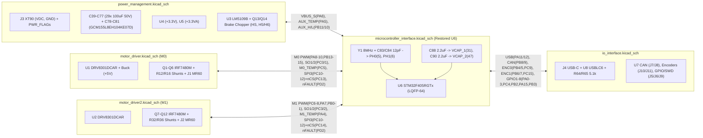

# V8 Schematic STM32 Pinout Restoration, PCB Parity, and ERC Cleanup Plan

## 1. Scope, Clarified Decisions, and Stated Assumptions

- **Confirmed User Decisions**:
  1. **Scope**: PCB parity + ERC and library-table/title-block cleanup while **keeping all existing electrical component values unchanged** (`C39–C77` stay `100uF 50V`, `Q1–Q12` stay `IRF7480MTRPBF`, `C83/C84` stay `12pF`, `C_HF1–C_HF6` & `C_AUX1` stay `100nF 100V`, etc.).
  2. **STM32 (`U6`) Pinout**: **Restore the exact 64-pin `STM32F405RGTx` (`U6`) pinout from the original schematic** (`bldc_motor_cntroller/microcontroller_interface.sch` + `bldc_motor_cntroller-cache.lib`), fixing the 21 left-side pins (`PC0–PC15, PD2, PH0, PH1, VCAP_1, VCAP_2`) that were scrambled when KiCad 5's `-600..+600 mil` symbol was replaced with KiCad 10's `-700..+700 mil` `MCU_ST_STM32F4:STM32F405RGTx` symbol.

- **In Scope**:
  - `bldc_motor_cntroller/bldc_motor_cntroller_v8.kicad_sch` (root hierarchical sheet) and `bldc_motor_cntroller/bldc_motor_cntroller_v8.kicad_pro`
  - Shared hierarchical child sheets (`power_management.kicad_sch`, `motor_driver.kicad_sch`, `motor_driver2.kicad_sch`, `microcontroller_interface.kicad_sch`, `io_interface.kicad_sch`), preserving dual `(project "bldc_motor_cntroller" ...)` and `(project "bldc_motor_cntroller_v8" ...)` symbol instance bindings
  - Project-local KiCad 10 symbol and footprint libraries (`bldc_motor_cntroller.kicad_sym`, `bldc_motor_cntroller.pretty`, `MG-WDSON-8.pretty`, `Package_SON.pretty`, `sym-lib-table`, `fp-lib-table`)
  - Final netlist/field synchronization onto `bldc_motor_cntroller/bldc_motor_cntroller_v8.kicad_pcb` (`Unit 5`) so the restored `U6` pinout, `Y1`/`C83`/`C84` oscillator pins, `C88`/`C90` `VCAP` pins, `H1–H10` mounting holes, and `MPN`/BOM attributes match 1:1 between schematic and PCB without altering board dimensions, power pours, or power-stage placement

- **Out of Scope**:
  - Full signal autorouting of the remaining unrouted PCB nets on `bldc_motor_cntroller_v8.kicad_pcb` (`113` unrouted signal nets)
  - Component electrical value or voltage-rating redesign (`C39–C77` MLCC derating / external electrolytic bulk caps / `60 V` MOSFET substitution remain documented as pre-order BOM advisories only)
  - Firmware implementation

- **Stated Reversible Assumptions**:
  1. Because all `64` pins of `U6` (`STM32F405RGTx` LQFP-64) are occupied in the original ODrive v3.5/v3.6 pinout (`PC0=M0_SO1`, `PC1=M0_SO2`, `PC2=M1_SO2`, `PC3=M1_SO1`, `PC4=GPIO_5`, `PC5=M0_TEMP`), restoring the original `U6` pinout reclaims `PC0` and `PC1` for `M0_SO1` and `M0_SO2`. The auxiliary thermistor dividers `TH4/R62/C101` (`TEMP_SENSE_2` in `motor_driver.kicad_sch`) and `TH5/R63/C102` (`TEMP_SENSE_2` in `motor_driver2.kicad_sch`) are retained on their subsheets so `bldc_motor_cntroller_v8.kicad_pcb` keeps 100% component parity (`0` `extra_footprint` errors), with explicit `no_connect` flags on their root-sheet `TEMP_SENSE_2` pins (matching `nOCTW` and `PWRGD`).
  2. Title blocks across `bldc_motor_cntroller_v8.kicad_sch` and the 5 child sheets will be updated to `Title: Open Drive` (or subsheet functional title), `Revision: v8`, and an empty `Company: ""` to clear legacy third-party `Company: Dj140` / `X_Odrive` attribution per identity safety policy.
  3. All primary mutations execute strictly via `.copperpilot/tmp/staging/<operation-id>/candidate/` with baseline/post-promotion CLI verification; Git checkpoints will only be used if confirmed with the user in Build mode.

---

## 2. Reference & Evidence Mapping

| Functional Block / Decision | Reference ID / Artifact | Revision / Source | Role & Adaptation |
|---|---|---|---|
| **STM32F405RGT7 (`U6`) 64-Pin ODrive Mapping** | Original project `bldc_motor_cntroller/microcontroller_interface.sch`, `bldc_motor_cntroller.sch`, `bldc_motor_cntroller-cache.lib` + `odrive-sasasu` (`ODrive.kicad_sch`) | Baseline Oct 24 KiCad 5 `.sch` + `aa720cff554198ea71cac7a9456401e8a0286b54` (upgraded to KiCad `10.0.8`) | Exact pin-for-pin source for restoring all 21 scrambled left-side `U6` pins (`PH0/PH1`, `VCAP_1/2`, `PC0–PC15`, `PD2`) onto stock KiCad 10 `MCU_ST_STM32F4:STM32F405RGTx`. |
| **DRV8301DCAR (`U1`, `U2`) Pin Electrical Types & Gate Driver Subsheets** | `odrive-sasasu` (`.copperpilot/references/odrive-sasasu/source/drv8301.pdf`, `M0.kicad_sch`, `M1.kicad_sch`) | TI `DRV8301` Datasheet `SLOS719F` + `aa720cff554198ea71cac7a9456401e8a0286b54` | Authoritative pin types: `SDO` (`10`) = `tri_state`; `~{FAULT}` (`6`) & `~{OCTW}` (`5`) = `open_collector`; `AVDD` (`27`) & `DVDD` (`23`) = `power_out`; `GVDD` (`13`), `BST_A/B/C/BK` (`48,43,38,52`), `CP1/CP2` (`14,15`) = `passive`; `PH` (`50`=`output`, `51`=`passive`). |
| **3-Phase `MR60PB-M` (`J1, J2`) & `XT90` (`J3`) Connectors** | `garypippi-pippitank` (`.copperpilot/references/garypippi-pippitank/source/pcb/pippitank.kicad_sym`) + `bldc_motor_cntroller/Connector_AMASS.pretty` | `665d1d1d15a6fa854aae7045a3e9a7719a26daaa` (MIT, upgraded to KiCad `10.0.8`) | Verified connector footprint/symbol conventions; align `J3` `MPN` to `XT90PB-M` (`XT90`) matching `Value` and `AMASS_XT90-M_1x02_P10.90mm_Vertical`. |
| **Mounting Holes (`H1–H4`, `H7–H10`) & Board-Matched Custom Footprints** | `bldc_motor_cntroller/bldc_motor_cntroller_v8.kicad_pcb` | `SHA-256: 44bf46181547` (KiCad `10.0.8`) | Exact source for `H1–H4` (`MountingHole:MountingHole_3.2mm_M3_Pad_Via`), `H7–H10` (`MountingHole:MountingHole_4.3mm_M4_Pad` on `GND`), `C78–C81` (`GCM155L8EH104KE07D`), and custom embedded footprints (`DRV8301DCA`, `Infineon-MG-WDSON-8-05_2016-901-MFG`, `WSON-8_4x4mm_P0.8mm`, `CSTCE8M00G55-R0`, `TestPoint_Round`). |

---

## 3. Architecture & Restored Hierarchical Signal Flow

---

## 4. Incremental Execution Units

### Unit 1: Project-Local KiCad 10 Libraries & Title-Block Sanitization (`unit-1-project-libraries-and-title-blocks`)
- **Target Files (Staged)**:
  - `bldc_motor_cntroller/bldc_motor_cntroller.kicad_sym` & `bldc_motor_cntroller/sym-lib-table`
  - `bldc_motor_cntroller/bldc_motor_cntroller.pretty/*`, `bldc_motor_cntroller/MG-WDSON-8.pretty/*`, `bldc_motor_cntroller/Package_SON.pretty/*`, & `bldc_motor_cntroller/fp-lib-table`
  - Title blocks & `lib_symbols` references in `bldc_motor_cntroller_v8.kicad_sch`, `power_management.kicad_sch`, `motor_driver.kicad_sch`, `motor_driver2.kicad_sch`, `microcontroller_interface.kicad_sch`, `io_interface.kicad_sch`, and `bldc_motor_cntroller_v8.kicad_pro`
- **Concrete Actions**:
  1. Load `schematic-engineer` (`Design sequence`) and `schematic-conventions` (`Default conventions`) via `load_server_skill` before mutating schematic/library files.
  2. Create project-local KiCad 10 symbol library `bldc_motor_cntroller/bldc_motor_cntroller.kicad_sym` and register `bldc_motor_cntroller` (`${KIPRJMOD}/bldc_motor_cntroller.kicad_sym`) in `bldc_motor_cntroller/sym-lib-table` (replacing the hardcoded `/home/sam/...` legacy `.lib` URI with `${KIPRJMOD}` relative syntax):
     - Migrate `DRV8301DCAR-DRV8301DCAR` -> `bldc_motor_cntroller:DRV8301DCAR` preserving exact pin coordinates while updating pin electrical types per TI `DRV8301` datasheet (`SDO`=`tri_state`, `~{FAULT}`/`~{OCTW}`=`open_collector`, `AVDD`/`DVDD`=`power_out`, `GVDD`/`BST_A`/`BST_B`/`BST_C`/`BST_BK`/`CP1`/`CP2`=`passive`, `PH` pin `50`=`output` & pin `51`=`passive`).
     - Migrate `IRF7480MTRPBF-MG-WDSON-8` -> `bldc_motor_cntroller:IRF7480MTRPBF` preserving exact pin coordinates.
     - Migrate `Net-Tie_2-Device` -> `bldc_motor_cntroller:Net-Tie_2` with `(in_bom no)` matching `NT1–NT8` on `_v8.kicad_pcb`.
     - Update `J4` in `io_interface.kicad_sch` from missing `Connector:USB_C_Receptacle_USB2.0` to stock KiCad 10 `Connector:USB_C_Receptacle_USB2.0_16P` (or `bldc_motor_cntroller:USB_C_Receptacle_USB2.0` if stock pin coordinates differ, preserving exact wire endpoints).
  3. Extract the custom footprints embedded in `bldc_motor_cntroller_v8.kicad_pcb` via `kicad_copy` into project-local `.pretty` folders and register them in `bldc_motor_cntroller/fp-lib-table`:
     - `MG-WDSON-8.pretty/Infineon-MG-WDSON-8-05_2016-901-MFG.kicad_mod` (`MG-WDSON-8`)
     - `Package_SON.pretty/WSON-8_4x4mm_P0.8mm.kicad_mod` (`Package_SON`)
     - `bldc_motor_cntroller.pretty/DRV8301DCA.kicad_mod`, `CSTCE8M00G55-R0.kicad_mod`, `TestPoint_Round.kicad_mod`, and the existing board silk indicators (`M00, M1, batt, DFU, USB, ENC0, ENC1, ++`) (`bldc_motor_cntroller`), updating `Y1` (`bldc_motor_cntroller:CSTCE8M00G55-R0`) and `H5/H6` (`bldc_motor_cntroller:TestPoint_Round`) so stock `Crystal` and `TestPoint` (`TP1–TP6`) libraries are not shadowed.
  4. Update title blocks across `bldc_motor_cntroller_v8.kicad_sch` and the 5 child sheets via `set_kicad_project_page_settings` / staged sheet headers: replace `Company: "Dj140"` with `""`, set `Revision: "v8"`, and set root `Title: "Open Drive"`.
- **Exit Check**: `0` `lib_symbol_issues` and `0` `footprint_link_issues` in `run_erc`, and `0` forbidden company/author strings.

### Unit 2: Restore Original 64-Pin `U6` (`STM32F405RGTx`) Schematic Pinout (`unit-2-restore-u6-stm32-pinout`)
- **Target Files (Staged)**:
  - `bldc_motor_cntroller/microcontroller_interface.kicad_sch`
  - `bldc_motor_cntroller/bldc_motor_cntroller_v8.kicad_sch` (sheet-pin cleanup for `TEMP_SENSE_2` / `M0_TEMP2` / `M1_TEMP2`)
- **Concrete Actions**:
  1. Cleanly rewire all left-side pins (`x = 121.92 mm`) of `U6` (`MCU_ST_STM32F4:STM32F405RGTx` at `142.24, 93.98`) on the `1.27 mm` (`50 mil`) schematic connection grid to match `bldc_motor_cntroller/microcontroller_interface.sch` 1:1:
     - `Pin 7 (NRST)` at `(121.92, 53.34)` -> `C86.1` (`100nF 16V`, `C86.2 -> GND`)
     - `Pin 60 (BOOT0)` at `(121.92, 58.42)` -> `MCU_BOOT0`
     - `Pin 5 (PH0)` at `(121.92, 63.50)` -> `Y1.1` + `C83` (`12pF` to `GND`)
     - `Pin 6 (PH1)` at `(121.92, 66.04)` -> `Y1.2` + `C84` (`12pF` to `GND`, `Y1.3 -> GND`), positioning `Y1, C83, C84` cleanly aligned with `y = 63.50..66.04 mm`
     - `Pin 54 (PD2)` at `(121.92, 71.12)` -> `nFAULT`
     - `Pin 8 (PC0)` at `(121.92, 76.20)` -> `M0_SO1` (`ADC123_IN10`)
     - `Pin 9 (PC1)` at `(121.92, 78.74)` -> `M0_SO2` (`ADC123_IN11`)
     - `Pin 10 (PC2)` at `(121.92, 81.28)` -> `M1_SO2` (`ADC123_IN12`)
     - `Pin 11 (PC3)` at `(121.92, 83.82)` -> `M1_SO1` (`ADC123_IN13`)
     - `Pin 24 (PC4)` at `(121.92, 86.36)` -> `GPIO_5` (`ADC12_IN14`)
     - `Pin 25 (PC5)` at `(121.92, 88.90)` -> `M0_TEMP` (`ADC12_IN15`)
     - `Pin 37 (PC6)` at `(121.92, 91.44)` -> `M1_AH` (`TIM8_CH1`)
     - `Pin 38 (PC7)` at `(121.92, 93.98)` -> `M1_BH` (`TIM8_CH2`)
     - `Pin 39 (PC8)` at `(121.92, 96.52)` -> `M1_CH` (`TIM8_CH3`)
     - `Pin 40 (PC9)` at `(121.92, 99.06)` -> `M0_ENC_Z`
     - `Pin 51 (PC10)` at `(121.92, 101.60)` -> `SPI_SCK` (`SPI3_SCK`)
     - `Pin 52 (PC11)` at `(121.92, 104.14)` -> `SPI_MISO` (`SPI3_MISO`)
     - `Pin 53 (PC12)` at `(121.92, 106.68)` -> `SPI_MOSI` (`SPI3_MOSI`)
     - `Pin 2 (PC13)` at `(121.92, 109.22)` -> `SPI_M0_nCS`
     - `Pin 3 (PC14)` at `(121.92, 111.76)` -> `SPI_M1_nCS`
     - `Pin 4 (PC15)` at `(121.92, 114.30)` -> `M1_ENC_Z`
     - `Pin 31 (VCAP_1)` at `(121.92, 119.38)` -> `C88.1` (`2.2uF 16V`, `C88.2 -> GND`)
     - `Pin 47 (VCAP_2)` at `(121.92, 121.92)` -> `C90.1` (`2.2uF 16V`, `C90.2 -> GND`), relocating `C88` and `C90` cleanly next to `VCAP_1/VCAP_2`
  2. Remove all floating `x = 124.46 mm` legacy wire stubs in `microcontroller_interface.kicad_sch`, remove the non-original `M0_TEMP2` / `M1_TEMP2` hierarchical labels from `microcontroller_interface.kicad_sch` (and their corresponding sheet pins/wires on `Microcontroller Interface` in `bldc_motor_cntroller_v8.kicad_sch`), and place explicit `no_connect` flags on the `TEMP_SENSE_2` sheet pins of `/Motor Driver/` and `/Motor_Driver2/` on `bldc_motor_cntroller_v8.kicad_sch`.
- **Exit Check**: `query_design(what="pins", refs=["U6"])` matches all `64` pins of original `microcontroller_interface.sch` 100%; `0` `pin_not_connected`, `0` `pin_not_driven`, and `0` `isolated_pin_label` on `U6`, `U1`, and `U2`.

### Unit 3: Root & Subsheet PCB Parity (`H1–H10`, `MPN`, BOM Attributes) & ERC Cleanup (`unit-3-root-and-subsheet-parity-and-erc`)
- **Target Files (Staged)**:
  - `bldc_motor_cntroller/bldc_motor_cntroller_v8.kicad_sch`
  - `bldc_motor_cntroller/power_management.kicad_sch`
  - `bldc_motor_cntroller/motor_driver.kicad_sch`
  - `bldc_motor_cntroller/motor_driver2.kicad_sch`
  - `bldc_motor_cntroller/io_interface.kicad_sch`
- **Concrete Actions**:
  1. **Mounting Holes & Root Sheet Fixes (`bldc_motor_cntroller_v8.kicad_sch`)**:
     - Update `H1, H2, H3, H4` to `Footprint = MountingHole:MountingHole_3.2mm_M3_Pad_Via`, `Value = MountingHole_3.2mm_M3_Pad_Via`, and `(in_bom no)` matching `bldc_motor_cntroller_v8.kicad_pcb`.
     - Add `H7, H8, H9, H10` (`Mechanical:MountingHole_Pad`, `Value = MountingHole_Pad`, `Footprint = MountingHole:MountingHole_4.3mm_M4_Pad`, `(in_bom no)`) on `bldc_motor_cntroller_v8.kicad_sch` with pin `1` connected to `GND` (on the `1.27 mm` connection grid with dual project instances).
     - Remove the unmatched hierarchical sheet pin `PWRGD` (and its orphan `no_connect` at `51.054, 167.64`) on `/Motor_Driver2/` in `bldc_motor_cntroller_v8.kicad_sch` (`U2.4 PWRGD` is already marked `no_connect` inside `motor_driver2.kicad_sch`).
  2. **Field & BOM Attribute Parity Across Subsheets (Without Changing Electrical Values)**:
     - Update `C78, C79, C80, C81` in `power_management.kicad_sch` from `MPN = GMK105CC6105MV-F` to `MPN = GCM155L8EH104KE07D` matching `_v8.kicad_pcb` (`Value` stays `100nF 50V`).
     - Update `J3` in `power_management.kicad_sch` from `MPN = XT60` to `MPN = XT90PB-M` (`Value` stays `XT90`).
     - Align `(in_bom no)` on test points `TP1–TP6` and net-ties `NT1–NT8` across `power_management.kicad_sch`, `microcontroller_interface.kicad_sch`, `motor_driver.kicad_sch`, `motor_driver2.kicad_sch`, and `io_interface.kicad_sch` to match `exclude_from_bom` on `_v8.kicad_pcb`.
  3. **Power Flags & Net-Name / Off-Grid Label ERC Cleanup**:
     - Place `power:PWR_FLAG` symbols on `VDC`, `GND`, `+5V`, and `GVDD` in `power_management.kicad_sch` (`+3.3V` and `+3.3VA` are driven by `U4` and `U5`).
     - Replace redundant `power:GNDA` symbols tied directly to `GND` with `power:GND`, and replace redundant `power:VBUS` (`#PWR070`) tied directly to `+5V` with `power:+5V` (eliminating `multiple_net_names` while keeping netlist names `GND` and `+5V` unchanged).
     - Remove redundant local `SL_A` labels attached directly to `GND` on unshunted Phase A (`Q2`/`Q8`) in `motor_driver.kicad_sch` and `motor_driver2.kicad_sch`, convert local `GVDD` label in `motor_driver.kicad_sch` to match global `GVDD` (`0` `same_local_global_label`), snap the `0.127 mm` off-grid `SH_C` wire/label (`154.813 -> 154.94`) in `motor_driver.kicad_sch` and `motor_driver2.kicad_sch` (`0` `label_multiple_wires`), and realign `U7` pins `5`/`8` `no_connect` markers in `io_interface.kicad_sch`.
- **Exit Check**: `0` ERC errors across the entire `bldc_motor_cntroller_v8.kicad_sch` hierarchy (`run_erc` errors: `31 -> 0`).

### Unit 4: Schematic Phase Exit Gate & Senior Review Sweep (`unit-4-schematic-phase-exit-verification`)
- **Prerequisites**: Units 1–3 promoted and verified.
- **Concrete Actions**:
  1. Load `schematic-engineer` (`The omission sweep`) and `schematic-reviewer` (`Review sequence`) via `load_server_skill`.
  2. Export full KiCad XML netlist (`export_schematic_netlist` -> `241` components, `0` unannotated `?` references), run `run_erc` (without ignore flags), and run `validate_schematic_layout` across `bldc_motor_cntroller_v8.kicad_sch` and all 5 child sheets.
  3. Export schematic SVGs / PDF check to visually confirm clean left-side `U6` wiring, `H1–H10` mounting hole block, `PWR_FLAG` placement, and sanitized title blocks.
- **Exit Check**: `run_erc` = `0` errors (`0` `lib_symbol_issues`, `0` `footprint_link_issues`, `0` `multiple_net_names`, `0` `same_local_global_label`, `0` `label_multiple_wires`, `0` `isolated_pin_label`), and complete omission/review sweep documented.

### Unit 5: Sync Restored `U6` Netlist & Parity Metadata to `bldc_motor_cntroller_v8.kicad_pcb` (`unit-5-sync-v8-pcb-netlist-and-parity-gate`)
- **Target File (Staged)**:
  - `bldc_motor_cntroller/bldc_motor_cntroller_v8.kicad_pcb`
- **Concrete Actions**:
  1. Load `pcb-layout-engineer` (`Cleanup and verification`) and `pcb-dfm-engineer` (`Sequence`) before PCB mutation/exit.
  2. In staged `bldc_motor_cntroller_v8.kicad_pcb`, unroute ONLY the `24` short copper segments belonging to the 4 previously scrambled `U6` local nets (`Net-(U6-PH0)`, `Net-(U6-PH1)`, `Net-(U6-PC3)`, `Net-(U6-PC4)`) via `unroute_pcb_net`.
  3. Run `sync_schematic_to_pcb` (`strict=true`) from `bldc_motor_cntroller_v8.kicad_sch` onto staged `bldc_motor_cntroller_v8.kicad_pcb` (preserving all existing `249` footprint coordinates, board outline, stackup, vias, and `53` copper zones while updating `U6`, `Y1`, `C83`, `C84`, `C88`, `C90` pad nets, linking `H7–H10` schematic UUIDs, updating `Y1`/`H5`/`H6` library nicknames, and syncing `MPN` fields onto footprints).
  4. Place `C88` (`VCAP_1`) and `C90` (`VCAP_2`) adjacent to `U6` `Pad 31` (`78.25, 50.675`) and `Pad 47` (`80.675, 41.75`) if needed for short `VCAP` decoupling loops (`0` courtyard overlaps), run `fill_pcb_zones` on the staged candidate (resolving the `8` stale zone-fill clearance violations), and verify with `run_drc`.
- **Exit Check**:
  - `run_drc` on promoted `bldc_motor_cntroller_v8.kicad_pcb` reports `0` `footprint_symbol_mismatch`, `0` `footprint_symbol_field_mismatch`, `0` `extra_footprint` on `H7–H10`, `0` electrical `net_conflict` on `U6`/all components (only the `64` unmapped thermal via pads `"V"` inside `U1/U2` footprint or `0` if mapped, plus the `8` decorative `G***` silk graphics if retained), `0` `lib_footprint_issues`, and `0` zone clearance errors.
  - Record all unit provenance entries in `.copperpilot/oracle/provenance.jsonl` and `.copperpilot/oracle/gates.json`.