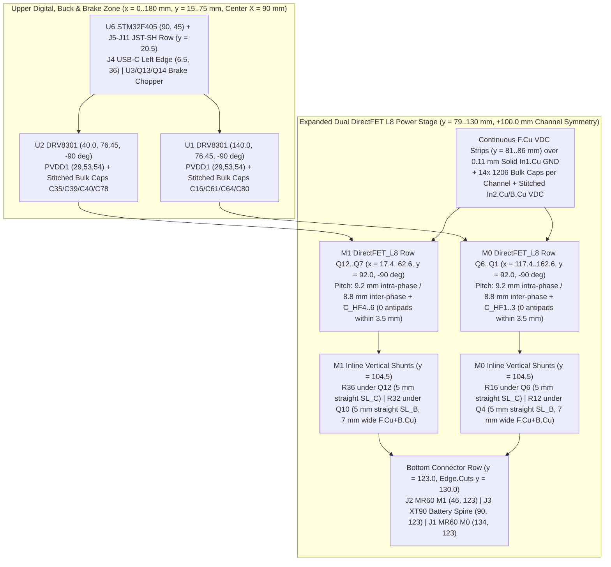

# V9.0 Rework Plan: DirectFET L8 (`IRF7759L2TRPBF` / `C520641`), `180 × 115 mm` Outline, and Power-Stage Copper Fixes

## 1. Scope & Assumptions

- **In Scope**:
  - Creating standalone `v9.0` artifacts (`bldc_motor_cntroller/bldc_motor_cntroller_v9.0.{kicad_pro,kicad_prl,kicad_dru,kicad_sch,kicad_pcb}` plus dedicated subsheets `motor_driver_v9.0.kicad_sch` and `motor_driver2_v9.0.kicad_sch`) so `v8.3` and all earlier revisions remain completely untouched.
  - Upgrading `Q1–Q12` from `IRF7480MTRPBF` (`DirectFET_ME`, `6.35 × 5.05 mm`) to **Infineon `IRF7759L2TRPBF`** (LCSC `C520641`, `75 V`, `160 A`, `2.3 mOhm` max / `1.8 mOhm` typ `Rds(on)`, **`Package_DirectFET:DirectFET_L8`**, `9.15 × 7.10 mm` body).
  - Expanding `Edge.Cuts` from `150.0 × 98.5 mm` to **`180.0 × 115.0 mm`** (`[0.0, 15.0]` to `[180.0, 130.0]`, `R = 5.0 mm`) with **inline Phase B/C shunts** (`R16`/`R12` under `Q6`/`Q4`; `R36`/`R32` under `Q12`/`Q10`) and fixing every `v8.3` power-stage fault (`SL_B` open islands, floating driver `VDC` bulk capacitor islands, and `In1.Cu` `GND` plane perforation).
  - Completing signal routing, DRC/ERC validation, and `DirectFET_L8` 3D STEP alignment checks on `v9.0`.
- **Out of Scope (Disclosed Engineering Constraints & Defaults)**:
  - Auxiliary brake-chopper MOSFETs `Q13–Q14` (`CSD18540Q5B` in `power_management.kicad_sch`), `DRV8301DCAR` (`U1–U2`, `60 V` abs max `PVDD`), and `50 V` `1206` ceramic bus capacitors remain at their existing BOM part numbers; bus voltage remains limited by `DRV8301` (`<= 60 V` abs max) and `50 V` capacitor derating despite the `75 V` FET upgrade.
  - **DRV8301 Gate-Drive Thermal/Current Constraint**: `IRF7759L2TRPBF` has `Qg = 200 nC` typ (`300 nC` max) at `Vgs = 10 V`. Six switching MOSFETs per `DRV8301` draw `I_GVDD = 6 * 200 nC * f_PWM = 28.8 mA` at `24 kHz` (against `DRV8301`'s `30 mA` RMS `GVDD` rating). Firmware PWM frequency must be kept `<= 20–24 kHz` (default `20 kHz` recommended for `Qg(max)` margin); existing `2.2 Ohm` gate resistors (`R1, R2, R8, R9, R13, R14, R24, R25, R28, R29, R33, R34`) are retained by default.
  - Firmware source code and mechanical enclosure CAD are out of scope.

---

## 2. Evidence & Reference Traceability

- **MOSFET Datasheet & Package Land Pattern (`exact_reference` for package/symbol)**:
  - Infineon `IRF7759L2PbF` datasheet & Infineon `AN-1035` Appendix A.28 (`L8-outline`, `9.15 × 7.10 mm` max body, 6 Drain flange pads, 1 center-offset Gate pad, 8 Source pads), LCSC `C520641`.
  - Installed KiCad 10.0.8 stock symbol: `Transistor_FET:IRF7759L2` (`/usr/share/kicad/symbols/Transistor_FET.kicad_sym`, pins `1=D`, `2=G`, `3=S`).
  - Installed KiCad 10.0.8 stock footprint: `Package_DirectFET:DirectFET_L8` (`/usr/share/kicad/footprints/Package_DirectFET.pretty/DirectFET_L8.kicad_mod`, `15` SMD pads, courtyard `10.60 × 7.46 mm` unrotated -> `7.46 × 10.60 mm` at `-90°`, `(duplicate_pad_numbers_are_jumpers no)` ensuring external copper verification across all 6 Drain pads and 8 Source pads).
  - Installed KiCad 10.0.8 3D model: `${KICAD10_3DMODEL_DIR}/Package_DirectFET.3dshapes/DirectFET_L8.step`.
- **Dual-Channel DRV8301 BLDC Architecture & Connectors (`adapted_partial_reference`)**:
  - `.copperpilot/references/odrive-sasasu/source/` (`aa720cff554198ea71cac7a9456401e8a0286b54`, upgraded in place to KiCad 10.0.8; inspect-only architectural reference for `DRV8301DCAR`, gate resistors, Kelvin shunt RC filters, and buck/brake topology).
  - `.copperpilot/references/garypippi-pippitank/source/` (`665d1d1d15a6fa854aae7045a3e9a7719a26daaa`, `AMASS_MR60PB-M` connector reference).

---

## 3. Target `v9.0` Physical & Electrical Architecture (`180.0 × 115.0 mm`)

### Key Geometrical & Copper Solutions
1. **`DirectFET_L8` Orientation & Zero-Via `F.Cu` Gate Exit (`rot = -90°`)**:
   - At `-90°`, each `DirectFET_L8` spans `6.10 × 10.10 mm` in pads (`7.46 × 10.60 mm` courtyard):
     - North Drain flange (`Pad 1`, 3 pads): `y = Y0 - 4.50` (`[-3.05..+3.05, -5.05..-3.95]`).
     - South Drain flange (`Pad 1`, 3 pads): `y = Y0 + 4.50` (`[-3.05..+3.05, +3.95..+5.05]`).
     - Gate (`Pad 2`, 1 pad): `(X0, Y0 - 2.25)`, centered inside an **unobstructed `2.55 mm` tall horizontal channel (`Y0 - 3.95 .. Y0 - 1.40`)** on both `-X` and `+X` sides. Every gate routes laterally (`0.40 mm` trace on `F.Cu`) into the `2.70–3.10 mm` inter-FET pad gap and straight North into `R_gate` (`y = 85.0 mm`) with **zero vias** in the gate path.
     - Central Source array (`Pad 3`, 8 pads): `y = Y0 - 0.85` and `Y0 + 1.95` (`[-2.15..+2.15, -1.40..+2.50]`), with a **`7.90 mm` tall Drain-free side window (`Y0 - 3.95 .. Y0 + 3.95`)** allowing `>= 6.5 mm` wide lateral copper exit on `F.Cu`.
2. **Eliminating the `SL_B` Open Circuit & `SH_C` Crossover (Fault #1 Fixed)**:
   - Channel M0 FET X-centers (`y = 92.00 mm`): `Q6 = 117.40`, `Q5 = 126.60`, `Q4 = 135.40`, `Q3 = 144.60`, `Q1 = 153.40`, `Q2 = 162.60` (`9.20 mm` intra-phase, `8.80 mm` inter-phase; M1 exact `-100.00 mm` translation at `17.40 .. 62.60 mm`).
   - Vertical `2512` shunts `R16` (`x = 114.0, y = 104.5`) and `R12` (`x = 132.0, y = 104.5`) sit directly under the West Source exit of `Q6` and `Q4` (mirrored on M1 at `R36 x = 14.0`, `R32 x = 32.0`).
   - Both `SL_C` and `SL_B` run **straight South `~5 mm` at `6.5–7.0 mm` width on BOTH `F.Cu` (over `0.11 mm` `In1.Cu` `GND`) and `B.Cu`**, while `SH_C` (`7.5 mm` wide) flows straight South through the `14.3 mm` clear corridor between `R16` and `R12` into `J1`, `SH_B` (`7.5 mm` wide) flows East of `R12` into `J1`, and `SH_A` (`8.5 mm` wide) flows South of `Q1/Q2` into `J1`.
   - Coupled Kelvin differential pairs (`SP2/SN2` at `x = 110.5`, `SP1/SN1` through the `2.70 mm` `Q5–Q4` inter-phase gap at `x = 131.0`) route straight North into `U1` pins `30–33`.
3. **Stitching Driver `VDC` Bulk Capacitors & `PVDD1` (Fault #2 Fixed)**:
   - Driver-side `VDC` capacitor banks (`C16, C61, C64, C80` on M0 and `C35, C39, C40, C78` on M1) plus all per-leg `1206` bus capacitor banks get dedicated `0.60 / 0.30 mm` `VDC` via arrays directly down to `In2.Cu` / `B.Cu` and adjacent `0.60 / 0.30 mm` `GND` vias straight down `0.11 mm` into `In1.Cu`.
   - `U1/U2` `PVDD1` (`pins 29, 53, 54`) and `100 nF` local bypasses connect directly into the stitched `F.Cu` `VDC` copper and `In1.Cu` `GND`.
4. **Preserving Solid `In1.Cu` Return Plane Under the FET Row (Fault #3 Fixed)**:
   - Because `F.Cu` sits `0.11 mm` above `In1.Cu` (`GND`) while `In1.Cu`-to-`In2.Cu` is `1.17 mm`, every fast switching commutation path (`1206` `VDC` row + `C_HF1–C_HF6` -> HS Drain -> LS Source -> `In1.Cu` `GND`) stays on `F.Cu` directly over `In1.Cu`.
   - **Strict Antipad Keep-Out Rule**: Zero `SL_*`, `SH_*`, or `VDC` vias inside `[y = 86.0 .. 97.5 mm]` under the FET bodies or within a `3.5 mm` radius of `C_HF1–C_HF6` (`GND` vias only in that strip, bonding `F.Cu` `GND` pads directly to `In1.Cu`).
   - DC current-sharing via arrays (`F.Cu <-> B.Cu` for `SH_A/B/C` and `SL_B/C`, and `F.Cu <-> In2.Cu/B.Cu` for `VDC`) are placed strictly **North of `y = 83.5 mm`** (along the bulk cap bus) and **South of `y = 98.5 mm`** (along the wide phase/shunt trunks), maintaining **`>95%` solid `In1.Cu` `GND` fill** across the entire FET commutation zone and around every `C_HF` capacitor.

---

## 4. Incremental Execution Units

### Unit 1 (`unit-1-v9-0-branch-and-irf7759l2-schematic`)
- Copy `v8.3` into staged `bldc_motor_cntroller_v9.0.{kicad_pro,kicad_prl,kicad_dru,kicad_sch,kicad_pcb}` and copy `motor_driver.kicad_sch` / `motor_driver2.kicad_sch` into `motor_driver_v9.0.kicad_sch` / `motor_driver2_v9.0.kicad_sch`.
- Update root `bldc_motor_cntroller_v9.0.kicad_sch` `Sheetfile` references to `motor_driver_v9.0.kicad_sch` and `motor_driver2_v9.0.kicad_sch`, set title-block revision to `v9.0`, and register `bldc_motor_cntroller_v9.0` symbol/sheet instances across the hierarchy.
- Replace `Q1–Q6` (in `motor_driver_v9.0.kicad_sch`) and `Q7–Q12` (in `motor_driver2_v9.0.kicad_sch`) with `Transistor_FET:IRF7759L2` (`Value = IRF7759L2TRPBF`, `Footprint = Package_DirectFET:DirectFET_L8`, `MPN = IRF7759L2TRPBF`, `LCSC = C520641`), wiring `Pin 1 (D)`, `Pin 2 (G)`, and `Pin 3 (S)` cleanly on the schematic connection grid.
- Normalize `DRV8301DCA` thermal via jumper pads (`V -> 57`) and `G***` board-only graphic attributes so `v9.0` reaches `0` schematic-parity errors on sync.
- **Exit Gate**: `run_erc` (`0` errors), `validate_schematic_layout`, XML netlist export verification, promote Unit 1 files, and re-verify primary `v9.0` schematic while confirming `v8.3` files have unchanged SHA-256 hashes.

### Unit 2 (`unit-2-expand-180x115-and-place-directfet-l8-stage`)
- Stage `bldc_motor_cntroller_v9.0.kicad_pcb`, run `sync_schematic_to_pcb` to swap `Q1–Q12` onto `Package_DirectFET:DirectFET_L8` (`15` pads each + `${KICAD10_3DMODEL_DIR}/Package_DirectFET.3dshapes/DirectFET_L8.step`).
- Update `Edge.Cuts` outline to `[0.0, 15.0] .. [180.0, 130.0]` (`180.0 × 115.0 mm`, `R = 5.0 mm`).
- Translate upper-board components (`y < 72.0 mm`) by `+15.0 mm` in X (`center X = 90.0 mm`), keeping left-edge USB-C cluster (`J4, U8, F1, D4, R52, R53, R64, R65, TP4, TP5`) anchored at the left edge (`x = 6.5..21.5`), corner/side mounting holes (`H1–H4`, `H7–H10`) and fiducials (`FD1, FD2`) at the new `180 × 115 mm` perimeter.
- Place symmetrical M1 (`center X = 40.0 mm`) and M0 (`center X = 140.0 mm`) power stages:
  - `U2` `(40.0, 76.45, -90°)` and `U1` `(140.0, 76.45, -90°)` + local passives and stitched `VDC` bulk banks (`C35/C39/C40/C78`, `C16/C61/C64/C80`, and `28×` `1206` bus caps).
  - Gate resistors at `y = 85.0 mm`, `Q12..Q7` (`x = 17.40..62.60, y = 92.00, -90°`) and `Q6..Q1` (`x = 117.40..162.60, y = 92.00, -90°`), and `C_HF1–C_HF6` (`<= 2.5 mm` loop).
  - Inline vertical `2512` shunts `R36` `(14.0, 104.5, -90°)`, `R32` `(32.0, 104.5, -90°)`, `R16` `(114.0, 104.5, -90°)`, `R12` `(132.0, 104.5, -90°)` with adjacent Kelvin net-ties `NT1–NT8` and `120R` resistors `R11, R15, R31, R35`.
  - Bottom connectors `J2` `(46.0, 123.0, 180°)`, `J3` `(90.0, 123.0, 0°)`, and `J1` `(134.0, 123.0, 180°)`.
- **Exit Gate**: `query_design(what="overlaps")` = `0` courtyard/outline overlaps, `0` schematic-parity errors in `run_drc`, promote Unit 2.

### Unit 3 (`unit-3-power-pours-vdc-cap-stitching-and-solid-in1-gnd`)
- Expand `In1.Cu` (`GND`, `[1.0, 16.0]..[179.0, 129.0]`) and `In2.Cu` (`+3.3V` upper logic zone + `VDC` power plane `[1.0, 74.0]..[179.0, 129.0]`).
- Build symmetric `F.Cu` and `B.Cu` copper zones for `VDC` (top commutation strips + `J3.2` battery spine), `SH_A`, `SH_B`, `SH_C` (`7.5–8.5 mm` wide), straight `5 mm` `SL_B` and `SL_C` (`6.5–7.0 mm` wide on both `F.Cu` and `B.Cu`), quiet outer `GND` (`y < 82.2`), and isolated high-current shunt-return `GND` spine (`y = 108.0..128.5` into `J3.1`).
- Place `0.60 / 0.30 mm` `VDC` and `GND` stitching via arrays on **all** `VDC` bulk capacitors (explicitly verifying `C16, C61, C64, C80` and `C35, C39, C40, C78` have multi-via `VDC` -> `In2.Cu`/`B.Cu` and `GND` -> `In1.Cu` connections) and place DC current-sharing via arrays strictly outside `[y = 86.0 .. 97.5 mm]` and `>3.5 mm` from `C_HF1–C_HF6`.
- Refill zones (`fill_pcb_zones`) and run a geometric copper-fill audit script verifying `>95%` solid `In1.Cu` `GND` area under both FET rows and within `3 mm` of `C_HF1–C_HF6`, plus `0` isolated copper islands and continuous `SL_B` / `SL_C` / `SH_A/B/C` connectivity on both `F.Cu` and `B.Cu`.
- **Exit Gate**: `0` physical copper/clearance/dangling-via DRC errors on `run_drc`, verified layer PNG renders (`F.Cu`, `In1.Cu`, `In2.Cu`, `B.Cu`), promote Unit 3.

### Unit 4 (`unit-4-route-gate-kelvin-and-drv8301-power-nets`)
- Route power-stage critical signal groups via headless FreeRouting (`route --nets`) in priority order:
  1. Group 4A: `Q1–Q12` lateral `F.Cu` gate traces (`Pad 2 -> R_gate -> U1/U2 GH_*/GL_*`) and `SH_*/SL_*/BST_*` sense/bootstrap taps (`0` vias in gate paths).
  2. Group 4B: Coupled Kelvin differential pairs (`SP1/SN1`, `SP2/SN2` on M0 and M1 from `NT1–NT8`/`R11,R15,R31,R35` through quiet/inter-phase corridors to `U1/U2` pins `30–33` and `SO1/SO2` to `U6`).
  3. Group 4C: `U1/U2` `PVDD1` (`pins 29, 53, 54`), `GVDD`, `AVDD`, `DVDD`, charge-pump (`CP1/CP2`), and `U1` buck converter nets.
- **Exit Gate**: Refill zones, verify `0` unconnected pins across all power-stage nets, `0` copper DRC errors, and intact `>95%` `In1.Cu` `GND` solidity under `Q1–Q12` / `C_HF1–C_HF6`, promote Unit 4.

### Unit 5 (`unit-5-route-upper-mcu-io-and-final-v9-0-verification`)
- Route remaining upper-board signal groups via headless FreeRouting (`route --nets`) over continuous `In1.Cu` `GND`:
  1. Group 5A: `USB_DP` / `USB_DN` (`90 Ohm` pair with skew check) and `CAN` (`CANH/CANL`, `CAN_D/CAN_R`).
  2. Group 5B: `U6` local crystal/resonator `Y1`, `VCAP1/2`, `NRST`, `BOOT0`, `LDO` rails (`+5V`, `+3.3V`, `+3.3VA`), and `LM5109B` (`U3` / `Q13` / `Q14`) brake chopper.
  3. Group 5C: `M0/M1` 6-PWM buses, `SPI3` + chip-selects, `EN_GATE/nFAULT/nOCTW/PWRGD`, `ENC0/ENC1`, `SWD`, `GPIO1–8`, and `TH1–TH5` thermistors.
- Clean up colliding `F.SilkS` designators, update board revision silkscreen to `"Open Drive Rev v9.0"`, refill all copper zones, and run final verification:
  - `run_erc` on `bldc_motor_cntroller_v9.0.kicad_sch` (`0` errors).
  - `run_drc` on `bldc_motor_cntroller_v9.0.kicad_pcb` (`0` errors, `0` `unconnected_items`, `0` `schematic_parity`).
  - `review_pcb_footprint_3d_model` on representative `Q1` (`DirectFET_L8.step`) and critical connectors/ICs.
- **Exit Gate**: Promote final `v9.0` files, verify `v8.3` primary hashes remain untouched, and write `v9.0` completion summary note.