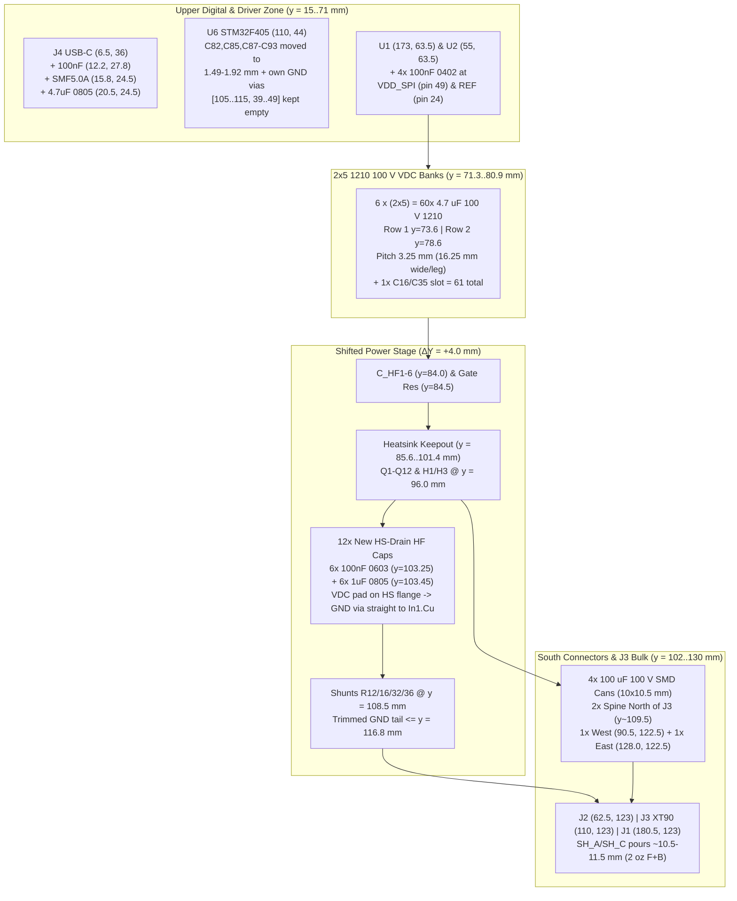

# V9_10 Plan: South-Shift Power Stage (+4.0 mm), 100 V 1210/HF/Bulk Decoupling, U6/DRV/USB Bypass, and Full Routing

## 1. Scope & Assumptions

- **In Scope (`bldc_motor_cntroller_v9_10/` only; `v9_9` and earlier untouched):**
  - Branch a standalone `bldc_motor_cntroller_v9_10/` project from `bldc_motor_cntroller_v9_9/`, updating project stems, sheet-instance paths, and title-block revision to `v9_10`.
  - **South Shift (`ΔY = +4.0 mm`) & `2×5` `1210` `100 V` VDC Banks**: Shift `Q1–Q12`, `H1`/`H3`, the 13 heatsink component keepouts + 2 via keepouts, `C_HF1–C_HF6`, gate resistors (`R1–R14`, `R24–R34`), NTCs (`TH1`/`TH5` dividers), current shunts (`R12`, `R16`, `R32`, `R36`), and Kelvin sense passives (`R11/15/31/35`, `NT1–NT8`) southward by `+4.0 mm` (`Q1–Q12` & `H1/H3` `y = 92.0 -> 96.0 mm`, heatsink keepout `y = 85.6..101.4 mm`, shunts `y = 108.5 mm`). This opens `11.65 mm` North of `C_HF`/gate resistors (`y = 70.87..82.52`) to fit `6 × (2 × 5)` **`1210` `4.7 µF 100 V` X7R** MLCC banks (`GRM32ER72A475KE14L`, LCSC `C162515`; all 61 existing `1206` `50 V` `VDC` positions upgraded to `100 V` `1210`, yielding `~115–186 µF` effective at `48 V` with `>2×` voltage rating).
  - **12× Per-Half-Bridge `100 V` HF MLCCs**: Add `6×` `100 nF 100 V X7R 0603` (`GCM188R72A104KA64D` / LCSC alt `CL10B104KC8NNNC` `C15725`) + `6×` `1 µF 100 V X7R 0805` (`0805B105K101NT`, `C396883`) placed vertically (`rot = 90°`) at each HS FET south `VDC` drain flange (`y = 103.25 / 103.45 mm`, `0.35 mm` clear south of the `y = 101.4` heatsink keepout) with dedicated `0.60/0.30 mm` `GND` vias straight to `In1.Cu` (`0.11 mm` below `F.Cu`).
  - **4× `J3` (`XT90`) `100 V` Bulk SMD Capacitors**: Add `4×` `100 µF 100 V` high-ripple `10 × 10.5 mm` SMD capacitors (`HV1K107M1010PZ`, LCSC `C42436546`, `1600 mA RMS @ 100 kHz`, `120 mΩ ESR`, `Capacitor_SMD:CP_Elec_10x10.5`) — `2×` in the shifted center `VDC`/`GND` spine north of `J3` (`y ≈ 109.5`, inside `y = 101.6..117.6`) and `2×` flanking `J3` (`1×` West at `~90.5, 122.5`, `1×` East at `~128.0, 122.5`) to damp hot-plug ringing and handle `6.4 A RMS` bulk ripple.
  - **STM32 `U6` Bypass & VCAP Relocation**: Move all 9 existing `0402` capacitors (`C85, C92, C93, C82, C88, C87, C90, C91, C89`) from `5.28–7.90 mm` to **`1.49–1.92 mm`** on `F.Cu` right outside `U6`'s courtyard (`[103.3, 37.3, 116.7, 50.7]`) with dedicated `GND` vias, preserving the empty `[105..115, 39..49]` under-body keepout.
  - **DRV8301 `VDD_SPI` & `REF` Decoupling**: Add `4×` `100 nF 50 V X7R 0402` (`CC0402KRX7R9BB104`, `C131394`) within `1.56–2.49 mm` of `U1.49` (`VDD_SPI`), `U1.24` (`REF`), `U2.49` (`VDD_SPI`), and `U2.24` (`REF`) with dedicated `GND` vias (`LP5907MFX-3.3` on `+3.3VA` is stable with `1–10 µF` ceramic, so `+200 nF` total on `REF` is safe).
  - **USB `J4` VBUS Protection & Decoupling**: Add `SMF5.0A` (`C2857263`, `Diode_SMD:D_SOD-123F`, `200 W`, `V_C = 9.2 V`) + `4.7 µF 25 V X7R 0805` (`CL21B475KAB6PNE`, `C16194942`, keeping local VBUS `<= 10 µF` per USB 2.0) on `Net-(D4-A)` (post-`F1`, pre-`D4`) plus `100 nF 50 V 0402` (`C131394`) on `Net-(F1-Pad1)` immediately at `J4` VBUS.
  - **Full Routing Completion**: Route all displaced/added nets plus close the `84` inherited `v9_9` unconnected items (`71` `GND`/`+3.3V` plane ties, `4` trapped `U6` exits, `5` supply pinches, `4` local taps) and clear the `7` inherited minor clearance errors.
- **Known Trade-Offs & Safety Notes:**
  - Shifting `Q1–Q12` `+4.0 mm` south narrows the `SH_A`/`SH_C` diagonal phase trunks from `12.3–12.5 mm` to **`~10.5–11.5 mm`** (re-angled toward `y = 126.4` on `2 oz` `F.Cu`+`B.Cu`, still well above the `8.97 mm` IPC-2152 plane-adjusted width for `30 A RMS`) and trims the shunt `GND` pour tail by `1–2 mm` (`>= 5.5 mm` south of pad 1, clear of `J1`/`J2` courtyard `y = 117.60`).
  - Downstream of `D4`, the `+5V` rail already holds `97 µF` (`C12/C18/C19/C49/C50`); when powered exclusively from USB with `VDC` off, `D4` forward-biases and the host sees that inrush through `F1` (`500 mA`). Keep `D4` as-is unless a dedicated USB inrush limiter is later requested.
  - **Protected Routing Lever**: If the `5` `0.50 mm`-pitch `Supply`/`USB` pinches (`U1.13`/`U2.13` `GVDD`, `J4.A6` `USB_J4_DP`, `U4.2`/`U5.5` `+5V`) still cannot close under existing `0.30 mm`/`0.18 mm` rules after 3 FreeRouting retries, stop and request explicit approval via `ask_user_question` before relaxing `Supply` pad-entry width to `0.25 mm` or `USB` clearance to `0.16 mm` (both `>= 0.15 mm` JLCPCB `2 oz` min).

---

## 2. Power-Stage & Decoupling Layout Architecture

---

## 3. Units

| Unit ID | Placement / Target | Interface Signals (Global / Hier Labels) | Power Nets | Parts & Full MPNs | Validation Conditions | Dependencies / Order |
|---|---|---|---|---|---|---|
| `unit-1-v9-10-branch-and-power-stage-100v-sch` | `bldc_motor_cntroller_v9_10/motor_driver.kicad_sch` (A3) & `motor_driver2.kicad_sch` (A3) | Existing `/Motor Driver/*`, `/Motor_Driver2/*` untouched | `VDC`, `+3.3V`, `+3.3VA`, `GND` | Update 61× `1206` `VDC` caps (`C16,C35,C39–C77,C103–C132`) to Murata `GRM32ER72A475KE14L` (`C162515`, `4.7uF 100V X7R`, `C_1210_3225Metric`); add 6× `100 nF 100 V 0603` (`GCM188R72A104KA64D` / `CL10B104KC8NNNC` `C15725`, `C_0603_1608Metric`); add 6× `1 µF 100 V 0805` (`0805B105K101NT`, `C396883`, `C_0805_2012Metric`); add 4× `100 nF 50 V 0402` (`CC0402KRX7R9BB104`, `C131394`, `C_0402_1005Metric`) at `U1.49`, `U1.24`, `U2.49`, `U2.24` | Unit ERC `0` errors; all 61 `1210` caps + 12 HF caps + 4 DRV decoupling caps have verified MPN/LCSC/footprint fields; `v9_9` untouched | First (parallel with Unit 2 after branch) |
| `unit-2-j3-bulk-caps-and-usb-vbus-sch` | `bldc_motor_cntroller_v9_10/power_management.kicad_sch` (A3) & `io_interface.kicad_sch` (A4) | `Net-(F1-Pad1)`, `Net-(D4-A)` | `VDC`, `+5V`, `GND` | 4× `HV1K107M1010PZ` (`C42436546`, `100uF 100V`, `1600 mA RMS @ 100 kHz`, `Capacitor_SMD:CP_Elec_10x10.5`) across `VDC`–`GND`; 1× `SMF5.0A` (`C2857263`, `Diode_SMD:D_SOD-123F`) + 1× `CL21B475KAB6PNE` (`C16194942`, `4.7uF 25V X7R`, `C_0805_2012Metric`) on `Net-(D4-A)`–`GND`; 1× `CC0402KRX7R9BB104` (`C131394`, `100nF 50V`, `C_0402_1005Metric`) on `Net-(F1-Pad1)`–`GND` | Full-hierarchy `run_erc` = `0` errors; `validate_schematic_layout` clean; XML netlist confirms all 23 added caps/TVS + 61 upgraded `1210` caps; schematic omission/review sweep complete; promote `v9_10` schematics | Depends on Unit 1 branch (merges & verifies full schematic) |
| `unit-3-south-shift-1210-banks-hf-and-j3-bulk-pcb` | `bldc_motor_cntroller_v9_10/bldc_motor_cntroller_v9_10.kicad_pcb` (`y = 70..130 mm`) | `SH_A/B/C`, `SL_B/C`, `Q1–Q12` gates, Kelvin `SP/SN` | `VDC`, `GND` | Synced Unit 1–2 power parts (`61× C_1210`, `12×` HF `0603`/`0805`, `4× CP_Elec_10x10.5`); shifted `Q1–Q12`, `H1/H3`, heatsink keepouts, `C_HF1–6`, gate resistors, NTCs, `R12/16/32/36`, `R11/15/31/35`, `NT1–8` (`ΔY = +4.0 mm`) | Strict `sync_schematic_to_pcb` succeeds; `query_design(what="overlaps")` = `0`; heatsink keepout `y = 85.6..101.4` 100% clear of components; `2×5` `1210` banks at `y = 73.6/78.6`; 12 HF caps at `y = 103.25/103.45` with `GND` vias to `In1.Cu`; `4×` `CP_Elec_10x10.5` placed around `J3`; `SH_A`/`SH_C` trunks `>= 10.5 mm` (`2 oz` `F+B`); `>95%` solid `In1.Cu` `GND` under `Q1–Q12`; `0` parity errors | Depends on Unit 2 |
| `unit-4-u6-bypass-drv-and-usb-vbus-placement-pcb` | `bldc_motor_cntroller_v9_10/bldc_motor_cntroller_v9_10.kicad_pcb` (`U6`, `U1/U2`, `J4/F1/D4` regions) | `U6` local fanout (`~14` nets), `DVDD`, `Net-(F1-Pad1)`, `Net-(D4-A)` | `+3.3V`, `+3.3VA`, `+5V`, `GND` | Relocated `C85 (102.30,40.00)`, `C92 (102.30,46.25)`, `C93 (102.30,47.40)`, `C82 (107.25,51.65)`, `C88 (113.25,51.65)`, `C87 (114.50,51.65)`, `C90 (117.65,41.00)`, `C91 (117.65,39.85)`, `C89 (106.25,36.35)`; new `0402` at `U1.49 (178.25,68.80)`, `U1.24 (168.50,57.75)`, `U2.49 (58.75,68.80)`, `U2.24 (50.50,57.75)`; `SMF5.0A (15.8,24.5)`, `4.7uF (20.5,24.5)`, `100nF (12.2,27.8)` | All 9 `U6` bypass/VCAP caps `<= 2.0 mm` from pins (`1.49–1.92 mm`) with dedicated `GND` vias; `[105..115, 39..49]` under-`U6` keepout 100% empty; `4×` DRV caps within `1.56–2.49 mm`; `0` courtyard overlaps; `0` schematic-parity errors | Depends on Unit 3 |
| `unit-5-full-routing-drc-and-3d-verification` | `bldc_motor_cntroller_v9_10/bldc_motor_cntroller_v9_10.kicad_pcb` (full board) | All shifted power-stage/gate/Kelvin, relocated `U6` fanout, USB/DRV, and remaining `84` `v9_9` nets | `VDC`, `+5V`, `+3.3V`, `+3.3VA`, `GVDD`, `GND` | All `v9_10` footprints | All nets routed via headless FreeRouting (selective upper `In2.Cu`, solid `In1.Cu` `GND` & lower `In2.Cu` `VDC`); `run_erc` = `0` errors; `run_drc` = `0` copper/clearance/parity/unconnected errors; `query_design(what="overlaps")` = `0`; 3D render review of `C_1210`, `C_0805`, `CP_Elec_10x10.5`, `D_SOD-123F` passes; promote & Git checkpoint | Depends on Unit 4 |

---

## 4. Pre-Build Evidence Checks

1. **Live LCSC Stock & DC-Bias Verification**: Confirm live stock for `HV1K107M1010PZ` (`C42436546`, `100 µF 100 V 10×10.5 mm`, `1600 mA RMS`) and `GRM32ER72A475KE14L` (`C162515`; fallback `CQ3225X7R475K101NRK` `C5250080`) during Unit 1/2 before locking BOM fields.
2. **61st `1210` Slot Placement**: `6 × (2 × 5)` accounts for `60` `1210` capacitors across the 6 half-bridge legs; verify the 61st `1210` position (`C16`/`C35` pairing) during Unit 3 so all `61` synced `1210` footprints land cleanly on the `VDC`–`GND` bus strips with zero overlaps.