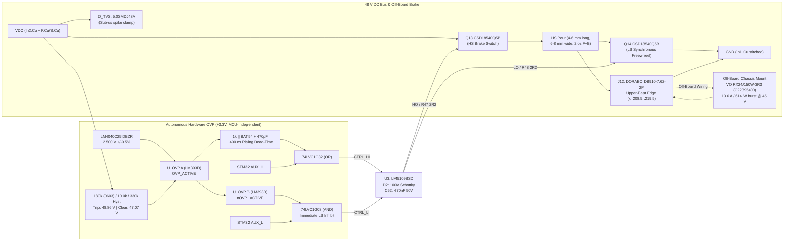

# V9_7 Plan: Brake-Resistor Screw Terminal (`DB910-7.62-2P-GN-S`), Upper-East Chopper Relocation, and Hybrid Hardware VDC OVP

## 1. Scope & Assumptions

- **In Scope (`bldc_motor_cntroller_v9_7/` only; `v9_6` and earlier untouched):**
  - Replace `H5` (`GND`) and `H6` (`/Power Management/HS`) in `power_management.kicad_sch` with a 2-pin `7.62 mm` screw terminal block **`J12`: DORABO `DB910-7.62-2P-GN-S`** (LCSC `C395876`, `30 A`, `300 V`, M3 screw, `0.5–4 mm²` wire) using a project-local KiCad 10 footprint verified against the LCSC `C395876` mechanical drawing.
  - Relocate the brake chopper cluster (`Q13`, `Q14`, `U3`, `D2`, `C41`, `C52`, `C48`, `C_AUX1`, `R43`, `R44`, `R47`, `R48`, `R51`, `TH3`, `C72`) from the crowded board center (`x = 97..123, y = 60..75`) to the open **Upper-East edge (`x = 180..206, y = 40..59`)** directly west of `J12` (`x = 208.5..219.5, y = 46.0..61.5`, wire entry facing East off `x = 220 mm`). Leave `R45`/`R46`/`C43` (`VBUS_S`) central near `U6`.
  - Feed `J12` with a short (`4–6 mm`), wide (`>= 6–8 mm` on `2 oz` `F.Cu` + `B.Cu`, well above the `3 mm` minimum for `14 A`) `/Power Management/HS` pour and stitched `GND` return into `In1.Cu`, completely clear of the `y = 81.6..97.4 mm` DirectFET heatsink keepout and preserving the South-center spine (`x = 94.5..125.5, y = 99.0..115.5`) for optional `63 V` bulk polymer capacitors.
  - Add **Hybrid Hardware VDC Overvoltage Protection (OVP)**:
    1. **Autonomous Comparator + Shoot-Through Interlock**: `LM393BIDR` + `LM4040C25IDBZR` (`2.500 V ±0.5%`) on a dedicated `180 kΩ / 10.0 kΩ / 330 kΩ` divider (tripping at **`48.86 V`**, clearing at **`47.07 V`**, worst-case `47.61–50.15 V`, completely independent of STM32 firmware and `/VBUS_SENSE`), driving `U3.HI` and `U3.LI` through `SN74LVC1G08DBVR` (AND) + `SN74LVC1G32DBVR` (OR) + `BAT54` RC dead-time (`~400 ns` break-before-make) so `Q14` is forced OFF before `Q13` turns ON even if `U6` stalls with `AUX_L = HIGH`.
    2. **Fast Transient Clamp**: Unidirectional **`5.0SMDJ48A`** (`5 kW`, `DO-214AB/SMC`, `V_RWM = 48 V`, `V_BR = 53.3–58.9 V`) TVS across `VDC`–`GND` to absorb sub-microsecond inductive / battery-disconnect spikes during the `~1.5 µs` comparator + dead-time turn-on window.
  - **Mandatory Pre-Existing Safety Fix (`D2` & `C52`)**: Upgrade `D2` from `MBR140SFT1G` (`40 V` `V_RRM`, under-rated on a `48–50 V` bus) to a `100 V, 1 A` Schottky (`STPS1H100A` or `B1100-13-F`), and upgrade `C52` from `100 nF 0402` (with mismatched MPN) to `470 nF 50 V X7R 0603` (`GRM188R71H474KA93D`) for `> 4×` bootstrap hold-time margin.
  - Document the off-board chassis-mount brake resistor (**`VO RX24/150W-3R3 ±5%`**, LCSC `C22395400`, plus `2 Ω` `C49375368` and `4.5 Ω` `C49375358` alternatives) as schematic/BOM notes only (not mounted on PCB).
- **Out of Scope / Assumptions:**
  - Unrelated `v9_7` routing (the 165 inherited unconnected upper-board items and 3 inherited `R55`/`U4`/`U5` clearance warnings) stays outside this delta unless directly touched by brake/OVP routing.
  - Assumes `48 V` PSU or `12S` LiPo max (`<= 50.4 V`, safely below `5.0SMDJ48A` `V_BR(min) = 53.3 V`). Do not connect a `13S` pack (`54.6 V`) without raising bus cap, FET, and TVS voltage ratings.

---

## 2. System Architecture & Protection Signal Flow

---

## 3. Thermal, Freewheel, Bootstrap, and Off-Board Resistor Analysis

### 3.1 Off-Board Brake Resistor Options (Chassis-Mount Only)
- **Default**: **VO `RX24/150W-3R3 ±5%`** (LCSC `C22395400`, `150 W` continuous on heatsink, `~55 W` free air). At `45 V` firmware trip: `13.6 A`, `614 W` burst (`<= 24%` duty for `150 W` avg); at `48.9 V` hardware OVP trip: `14.8 A`, `724 W` burst. Standard RX24 short-time overload rating is **`5×` rated power for `5 s`** (`750 W` for `5 s`), which covers `45–48.9 V` regen bursts **provided the aluminum housing is bolted flat to a metal chassis/heatsink plate with thermal compound**.
- **High-Regen Option**: **VO `RX24/200W-2R`** (LCSC `C49375368`, `200 W` cont, `5×/5 s = 1000 W`, `~22.5 A / 1013 W` at `45 V`; still within `30 A` `DB910-7.62` and `28 A` `CSD18540Q5B` ratings).
- **Gentle-Braking Option**: **`4.5 Ω, 110 W`** (LCSC `C49375358`, `10 A / 450 W` at `45 V`).

### 3.2 `Q13` / `Q14` (`CSD18540Q5B`) Freewheel & Thermal Budget (`13.6 A`, `R_thetaJA = 40 °C/W` on `1 in²` `2 oz` Cu)
- **`Q13` (`R_DS(on) = 1.8 mΩ` typ / `2.2 mΩ` max at `V_GS = 10 V`)**: `0.083–0.102 W` (`ΔT_J = 3.3–4.1 °C`) at `25%` duty; `0.333–0.407 W` (`ΔT_J = 13.3–16.3 °C`) at `100%` continuous fault. Safe.
- **`Q14` Synchronous Drive (`R_DS(on) = 1.8 / 2.2 mΩ`)**: `0.250–0.305 W` (`ΔT_J = 10.0–12.2 °C`) at `75%` (`1 - D`) duty. Cuts conduction loss by **`30×–40×`** vs. body diode.
- **`Q14` Body Diode Only (`V_SD = 0.75 V` typ / `1.20 V` max at `14 A`)**: For a resistive brake load, `Q14`'s body diode only conducts during the brief inductive decay of the wirewound resistor + cable (`L/R ≈ 1–10 µs`) after `Q13` turns off—safe during normal chopping and during hardware OVP (where `Q14` is intentionally forced OFF by `74LVC1G08`). However, **sustained** body-diode conduction at `13.6 A` (`2.55–4.08 W` at `25%` duty -> `ΔT_J = 102–163 °C`) is thermally destructive, so firmware should use synchronous `AUX_L` with `>= 200 ns` dead-time during normal PWM braking (while hardware OVP safely holds `LI = LOW` during emergency clamping).

### 3.3 `LM5109B` Bootstrap Self-Recharge Under Hardware OVP
- `LM5109B` has **no internal shoot-through interlock** (hence the mandatory `74LVC1G08`/`74LVC1G32` + `400 ns` dead-time circuit) and requires periodic `/HS` low intervals to recharge `C52` (`I_HB = 0.2 mA` typ / `0.4 mA` max, `HB–HS` UVLO `5.0 V` falling / `6.0 V` rising).
- With upgraded `C52 = 470 nF`, hold time is `4.3 ms` worst-case (`10.5 ms` typ), well above the `12–486 µs` required to discharge `C_bus` across the `1.8 V` hysteresis band (`48.86 V -> 47.07 V`).
- Whenever `Q13` turns OFF (either at `47.07 V` or via `HB–HS` UVLO during extreme `> 14.8 A` regen), the external `3.3 Ω` brake resistor pulls `/HS` to `GND` and recharges `C52` through `D2` in **`< 9 µs`**, producing safe self-recharging hysteretic clamping without needing `Q14` to turn on.

---

## 4. Units (Schematic & PCB Build Decomposition)

| Unit ID | Placement / Target | Interface Signals (Global / Hier Labels) | Power Nets | Parts & Full MPNs | Validation Conditions | Dependencies / Order |
|---|---|---|---|---|---|---|
| `unit-1-db910-footprint-and-brake-terminal-sch` | Region of `bldc_motor_cntroller_v9_7/power_management.kicad_sch` (`x=140..175, y=55..85` on existing sheet) + custom footprint in `bldc_motor_cntroller.pretty/` | `/HS` (hierarchical/internal), `Net-(D2-K)` | `VDC`, `GVDD`, `GND` | `J12`: `DORABO DB910-7.62-2P-GN-S` (LCSC `C395876`, `Connector:Screw_Terminal_01x02`); `D2`: `STPS1H100A` (or `B1100-13-F`, 100 V 1 A Schottky); `C52`: `GRM188R71H474KA93D` (`470 nF 50 V` X7R 0603); off-board BOM note: `VO RX24/150W-3R3` (`C22395400`) | Unit ERC 0 errors; `H5`/`H6` removed; `J12` pins 1=`/HS`, 2=`GND`; `D2` `V_RRM >= 100 V`; custom `DB910-7.62-2P` footprint verified against LCSC `C395876` PDF drawing | First (independent of Unit 2) |
| `unit-2-hw-ovp-comparator-interlock-tvs-sch` | Region of `bldc_motor_cntroller_v9_7/power_management.kicad_sch` (`x=20..95, y=80..130`, expand sheet to `A3` if needed) | `/CTRL_HI`, `/CTRL_LI` (from MCU `AUX_H`/`AUX_L`), internal `OVP_ACTIVE`, `nOVP_ACTIVE`, `OVP_ACTIVE_DLY`, `U3_HI_DRV`, `U3_LI_DRV` | `VDC`, `+3.3V`, `GND` | `U9`: TI `LM393BIDR` (SOIC-8); `D5`: TI `LM4040C25IDBZR` (SOT-23-3); `U10`: TI `SN74LVC1G08DBVR` (SOT-23-5); `U11`: TI `SN74LVC1G32DBVR` (SOT-23-5); `D6`: Nexperia `BAT54,215` (SOT-23); `D7`: Littelfuse `5.0SMDJ48A` (DO-214AB/SMC); `R_top`: Yageo `RC0603FR-07180KL` (180k 1% 0603); `R_bot` 10.0k, `R_hyst` 330k, `R_puA/B` 4.7k, `R_ref`/`R_dt` 1.0k, `R_mid1/2` 10.0k (0402 1%); `C_filt` 100pF (`GRM1555C1H101JA01D`), `C_dt` 470pF (`GRM1555C1H471JA01D`), `C_ovp1..3` 100nF (0402) | Unit ERC 0 errors; divider math `48.86 V / 47.07 V` verified; `/VBUS_SENSE` untouched; `U3.LI` gated by `nOVP_ACTIVE` before `U3.HI` rises (`~400 ns` dead-time); `D7` cathode on `VDC`, anode on `GND` | Parallel with Unit 1 |
| `unit-3-merge-and-verify-v9-7-schematic` | `bldc_motor_cntroller_v9_7/power_management.kicad_sch` + full `bldc_motor_cntroller_v9_7.kicad_sch` hierarchy | `/Microcontroller Interface/AUX_H`, `/Microcontroller Interface/AUX_L`, `/Microcontroller Interface/VBUS_S`, `/Power Management/HS` | `VDC`, `GVDD`, `+3.3V`, `GND` | All Unit 1 + Unit 2 parts + clean up MPN mismatches on `R43–R48`, `C41` | `run_erc` = 0 errors across full hierarchy; `validate_schematic_layout` clean; XML netlist confirms `J12.1=/HS`, `J12.2=GND`, `U3.2=U3_HI_DRV`, `U3.3=U3_LI_DRV`; promote staged schematic | Depends on Units 1 & 2 |
| `unit-4-relocate-brake-chopper-and-place-upper-east` | `bldc_motor_cntroller_v9_7/bldc_motor_cntroller_v9_7.kicad_pcb` (`x=175..220, y=35..68`) | All brake & OVP nets | `VDC`, `GVDD`, `+3.3V`, `GND` | Sync `J12`, `D2`, `C52`, `U9–U11`, `D5–D7`, OVP passives; relocate `Q13/Q14/U3/D2/C41/C52/C48/C_AUX1/R43,R44,R47,R48,R51,TH3,C72`; move logos `G1–G8` and 1 `GND` via | `sync_schematic_to_pcb` (strict) succeeds; `query_design(what="overlaps")` = 0; `J12` at `x=208.5..219.5, y=46..61.5` (East exit, clear of `H8`/`C18`/`C117`); `0` components inside `y=81.6..97.4` heatsink keepout; South-center spine (`x=94.5..125.5, y=99..115.5`) untouched | Depends on Unit 3 |
| `unit-5-hs-vdc-copper-pours-routing-and-verification` | `bldc_motor_cntroller_v9_7/bldc_motor_cntroller_v9_7.kicad_pcb` (Upper-East pours + brake/OVP routing) | `AUX_H`, `AUX_L`, `AUX_TEMP`, `GVDD`, `OVP_*`, `U3_HI_DRV`, `U3_LI_DRV`, `Net-(Q13-G)`, `Net-(Q14-G)`, `Net-(D2-K)` | `VDC`, `/Power Management/HS`, `+3.3V`, `GND` | Existing + Unit 4 parts; `In2.Cu` `VDC` extended north (`x=194..218, y=48..62.5`) after verifying zero `+3.3V` loads in that rectangle | `HS` pour `4–6 mm` long, `>= 6–8 mm` wide on `2 oz` `F.Cu`+`B.Cu` (`>> 3 mm` min); stitched `GND` vias into `In1.Cu`; all brake + OVP nets routed via headless FreeRouting with `0` new DRC errors and `0` parity errors; `run_erc` + `run_drc` + 3D audit (`DB910-7.62` noted as `missing_no_adequate_model` if no STEP); promote & Git checkpoint | Depends on Unit 4 |

---

## 5. Pre-Build Evidence Gaps to Resolve in Unit 1

1. **DORABO `DB910-7.62-2P-GN-S` (`C395876`) Mechanical Drawing**: Confirm exact body `L × W × H`, pin cross-section, recommended plated drill diameter (expected `~1.5–1.6 mm` for 30 A), and pin-to-wire-entry face offset directly from the LCSC `C395876` datasheet PDF before generating the custom `.kicad_mod` footprint.
2. **LCSC C-Numbers for OVP & Diode Parts**: Confirm live LCSC C-numbers and stock for `LM393BIDR`, `LM4040C25IDBZR`, `SN74LVC1G08DBVR`, `SN74LVC1G32DBVR`, `BAT54,215`, `5.0SMDJ48A`, `STPS1H100A`/`B1100-13-F`, and `GRM188R71H474KA93D` during Unit 1/2 before populating BOM fields.
3. **Off-Board RX24 Mounting Plate**: Verify exact mounting-hole spacing (`3.4 mm` vs `4.5 mm` holes) from the LCSC `C22395400` PDF before drilling the chassis heatsink plate.